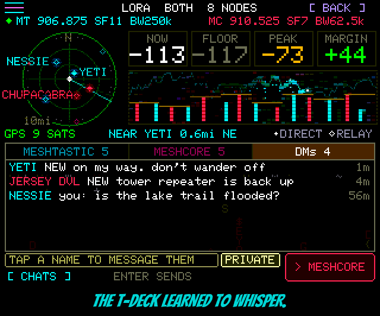

<!-- name: Return to Sender -->
<!-- board: T-Deck DMs: Meshtastic + MeshCore, with delivery ticks | Tap a radar dot to message it | The emulator gets a workbench and real board builds | Arlo mix-up fixed, WiFi scans go quiet -->
**Return to Sender.** The T-Deck learned to whisper. Until now everything it said on LoRa went out to the whole channel, like shouting across a campground. Now you can send one person a private message on Meshtastic or MeshCore, watch the dots while it travels, and get a little green tick when it lands. If it doesn't land after three tries, you get a red cross and Squachy takes it personally. "Address unknown. No such number. No such zone. I checked twice. I'm very thorough."

**A DMs tab.** The LORA page and LORA CHATS have a third tab beside MESHTASTIC and MESHCORE. One row per conversation, with a NEW count, and both networks in one list, each name in its network's colour. Tap a row to open it. The line you type into says PRIVATE, so you always know you're not about to tell the entire forest about your boot situation.

**Meshtastic DMs.** Sealed so only the person you sent it to can read it, with a delivery receipt and up to three tries. Proven both ways against a stock Meshtastic T-Deck. You can also tap somebody's line in the MESHTASTIC tab to start a conversation with them.

**MeshCore DMs.** MeshCore answers a private message by sending the receipt back the way the message came, which is where this release got its name. The T-Deck makes its own MeshCore identity, introduces itself, learns contacts from what it hears, and proved it both ways against a T-Deck Pro running MeshCore. "Return to sender. Specifically, return to me. I sent it."

**Tap a radar dot.** On the LORA page, tap a dot on the radar to message that node. Dots on the rim count too, for the shy ones.

**The emulator moved into a workshop.** squachwatch.com/emulator now puts each board on a cutting mat with a ruler and a USB cable, drawn around its live screen at its real size. Five boards on the shelf: the 2.8" CYD, the 3.5", the T-Deck, the T-Watch and the Cardputer. And the last three run their own firmware now, not the CYD's in a costume: type on the T-Deck's keyboard and press Enter for the LORA page, press the watch's crown, move the Cardputer's cursor with your arrow keys. The BOOT button under a CYD gives you real POCKET MODE. There's a Flash this board button on each, for when you're ready to commit. Squachy has never been so well lit.

**The Arlo that wasn't.** One maker code in the camera list said "Arlo" but really belongs to Espressif, the people who make the chip inside nearly every ESP32, including SquachWatch itself. So a dev board, a smart plug, or another SquachWatch could show up as a hidden camera. It's gone, and Arlo's three real codes are in its place. Thanks to at0m-b0mb, who also caught the next one (PR #114).

**WiFi scans keep quiet.** Opening WIFI SCAN, or picking a network for updates, used to send out a little "anyone there?" on every channel, with the board's own address on it. Now both just listen. Quicker, too. A new check stops a loud scan from ever sneaking back in. "I am a detector. I detect. I do not announce myself. Except to you. Hello."

**LOG under Privacy Mode.** Privacy Mode shortens device names, but the long-press confirm on LOG was shortening the type and maker too, so RING became RIN. Now only real names get trimmed. Thanks to fengqiaoqu (PR #102).

**New board: Waveshare ESP32-C5 2.8" (BETA).** A 2.8" touch board on the ESP32-C5, with 5 GHz WiFi scanning. Screen, touch, SD, WiFi and Bluetooth all work. It's build-from-source for now; docs/WAVESHARE-C5-28.md has the details. Thanks to bobsdinner-cell (PR #62).

**A GPS build for the Freenove S3 2.8".** Plug a GPS into the Freenove's UART port and the `freenove-s3-gps` build puts a position on SD log rows and alert cards, sets the clock from the sky, and writes WARDRIVE's WiGLE file. The pins are in docs/PINOUT.md. Also from bobsdinner-cell (PR #81). That's two in one release. We may have to start paying rent.

### The actually-useful part

**Added**
- T-Deck: Meshtastic direct messages (PKI-sealed), with ACKs, three tries, and dots / tick / red cross on each line.
- T-Deck: MeshCore direct messages: own Ed25519 identity kept in NVS, our advert before the first DM, contacts from adverts, three tries, receipts by path return or bare ACK.
- T-Deck: a DMs tab on the LORA page and in LORA CHATS covering both networks; compose chip reads PRIVATE there; tapping a line in the MESHTASTIC tab opens a DM with its sender.
- T-Deck: tap a radar dot (within 14 px, rim included) to open a DM with that node.
- T-Deck console: LORA MCKEYS, LORA MCADVERT, LORA MCDM.
- Emulator (squachwatch.com/emulator): a bench page with five boards drawn around the screen, Fit / Same scale / Actual size, a cm ruler, a Flash this board card, keys 1-5 to switch boards.
- Emulator: the T-Deck, T-Watch S3 and Cardputer ADV run their own builds (keyboard and LORA page, crown, cursor keys), each with its own saved settings; BOOT gives POCKET MODE on the CYDs.
- Arlo's own OUIs FC:9C:98, 48:62:64 and A4:11:62 as cameras, at High (PR #114 by at0m-b0mb).
- Waveshare ESP32-C5-Touch-LCD-2.8 (BETA, build from source): `waveshare-c5-28`, docs/WAVESHARE-C5-28.md (PR #62 by bobsdinner-cell).
- Freenove ESP32-S3 2.8": a GPS build, `freenove-s3-gps`, on the UART port: positions on SD rows and alerts, clock from GPS, WARDRIVE (PR #81 by bobsdinner-cell).
- Build checks: no active WiFi scan without a written reason; the OUI table is checked against the IEEE registry on demand and when it changes.

**Changed**
- WIFI SCAN and the update network picker scan passively (no probe requests).
- The online emulator is built from the released firmware again; it had been stuck on a v1.7-era build.
- Holding BOOT to power off has its own build flag, separate from the speaker one (no change on any shipped board).

**Fixed**
- BC:DD:C2 (Espressif) no longer reads as an Arlo camera, so ESP32 boards, including other SquachWatches, are not logged as cameras (PR #114 by at0m-b0mb).
- LOG long-press confirm under Privacy Mode no longer masks type and maker labels (PR #102 by fengqiaoqu, issue #92).
- Tab5: touch, after a merge moved two of its lines.
