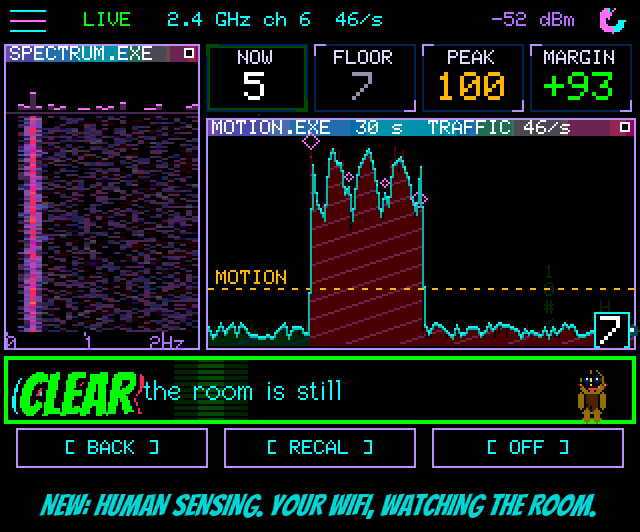

<!-- name: Breathe the Pressure -->
<!-- board: HUMAN SENSING: your WiFi as a motion sensor | Every ESP32 and S3 board, watch and Cardputer included | Polite retries when the router says no -->
**Breathe the Pressure.** Squachy has been sniffing the airwaves for cameras, trackers and skimmers since day one. Now he can feel the room itself. HUMAN SENSING turns your board's own WiFi radio into a motion sensor: no extra parts, no camera, no microphone, just the radio feeling the air push back when someone walks through the signal between your board and your router. "The air is thick with you. Respectfully. From a reasonable distance. Through the drywall."

**How it works.** Save your home WiFi in SETTINGS > WIFI NETWORKS, then open SETTINGS > HUMAN SENSING. The board joins, pings your router fifty times a second, and reads how the signal between them wobbles. An empty room hums along flat. A person walking through it makes the whole thing light up. Give it about 15 seconds of stillness to learn what "empty" looks like while it says PLEASE STAND BY, then go wander. Works best with you somewhere between the board and the router. Squachy suggests the hallway. Squachy always suggests the hallway.

**What's on the screen.** SPECTRUM is a waterfall of how fast the signal is changing, newest on top, the last 11 seconds sliding down a pixel at a time. The NOW / FLOOR / PEAK / MARGIN tiles tell you how loud the room is right now against how quiet it gets. MOTION is the last 30 seconds against the line that counts as movement, with a little rain of glyphs that gets busier when the room does. The banner says CLEAR, PRESENCE (someone moved in the last 15 seconds), or what the radio is up to, and Squachy reacts in the corner: pointing when something moves, crouching while he waits, snoozing in an empty room. "Something is moving. It's either you or the fridge. I've never trusted the fridge."

**Every board, every size.** The 2.8" and 2.4" CYDs, both 3.2" boards, the 3.5" boards, both Freenove S3s, the CrowPanel 7", the T-Deck, the T-Watch, the StickS3 and the Cardputer all get it, each with a layout drawn for its own screen. On the T-Deck, Backspace, R and O are BACK, RECAL and OFF. On the StickS3 and the Cardputer, the cursor's press re-calibrates and HOME leaves. The ESP32-C5 boards and the Tab5 sit this one out for now: their radios want a port of their own.

**One radio, taking turns.** The detector pauses while HUMAN SENSING is open and comes straight back when you press OFF or BACK. Switch the board off on this screen and it comes back to it. Privacy Mode keeps your network's name and your router's address off the screen and the console.

**Manners.** Some routers block a device that knocks too often. Our beta testers found that out the fun way, so if the router says no, the board now waits 20 seconds, then 40, then 80, up to every 5 minutes, and says so on the banner ("router said no, again in 40 s") instead of hammering on the door until it's banned. "I asked nicely. I will ask nicely again. In forty seconds. I'm very patient. I have literally nothing else to do."

**Thanks.** The motion maths comes from justcallmekoko's ESP32Marauder (its CsiMotionModel, MIT licensed), and the Discord testers flashed the LAB builds, hit every router wall there was, and told us about it. Squachy owes you all a snack.

### The actually-useful part

**Added**
- HUMAN SENSING (SETTINGS > HUMAN SENSING) on every ESP32 and ESP32-S3 board: WiFi channel-state motion sensing on the board's own radio, against the saved network's router. SPECTRUM waterfall (0-2.5 Hz, ~11 s, 1 px a row at 10 rows/s), NOW / FLOOR / PEAK / MARGIN tiles, MOTION graph (30 s), CLEAR / PRESENCE banner with a 15 s hold, RECAL / OFF / BACK. Motion model ported from ESP32Marauder's CsiMotionModel by justcallmekoko (MIT).
- A layout per screen size: 320x240, 400x240, 480x320, 240x240, 240x135 and 640x360.
- T-Deck: Backspace / R / O are BACK / RECAL / OFF on the sensing screen. StickS3 and Cardputer: one cursor stop on the banner (press = RECAL), HOME leaves.
- Emulator: a `sensing` screen (`SQUACHSIM_SENSE` picks the room) for checking the layouts at any size.
- Console: SENSE OPEN / CLOSE / SHOT and SENSE cal / rates / stat / joins.

**Changed**
- A board switched off on the sensing screen boots back into it.
- Not on the ESP32-C5 boards or the Tab5 yet.

**Fixed**
- (From the LAB builds) A refused join no longer retries ~19 times a minute until the router blocks the board: one try at a time, then waits of 20 s, 40 s, 80 s, 160 s and every 5 minutes, with the reason on the banner.
- (From the LAB builds) Pings come from the main loop on one socket instead of a task per join, which broke the memory up until the board went deaf, and could crash with too small a stack.
