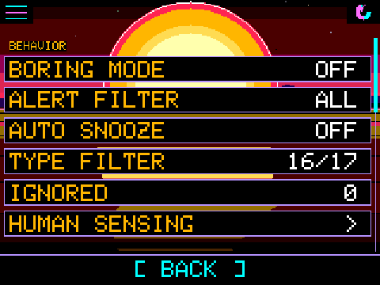

<!-- name: Just Breathe -->
<!-- board: HUMAN SENSING: your WiFi as a motion sensor | Now in the browser emulator too, on a demo room | Emulator controls back beside the board -->
**Just Breathe.** v1.42.0 taught every board to feel the room through WiFi, and then we shipped the browser emulator without it. The version number said 1.42.0. The Settings menu said "what sensing?" Squachy has been told. "I was IN the release. I had a whole GIF. They left me out of the website like a forgotten sock."

**Sensing in the browser.** The emulator on squachwatch.com now has SETTINGS > HUMAN SENSING, same screen as the boards. A browser has no WiFi radio to sense with, so it plays a made-up room on a loop: twelve seconds of nobody, eight seconds of somebody wandering through, then sixteen seconds of them sitting very still. The corner says DEMO where a board says LIVE, so nobody thinks their laptop has started watching them breathe. "It's not your room. It's a pretend room. The pretend person in it is fine. Mostly."

**Controls where you can see them.** On a wide screen, Simulate a detection and A SquachWatch nearby sit beside the board again instead of under it, and they stay put while you scroll, so you can press Trigger and watch the screen at the same time. On a phone they stack underneath as before.

**No firmware changes.** If your board is on 1.42.0, it already has everything in here. Updating does no harm, it just changes the number.

### The actually-useful part

**Added**
- Web emulator (CYD, T-Deck, T-Watch, Cardputer): HUMAN SENSING, fed by a 36 s demo loop (empty room, walking, sitting still) from sim/sense_cyd_sim.cpp; DEMO in place of LIVE in web builds only.

**Changed**
- Emulator page: the two control cards sit in a sticky column beside the board on screens 1040 px and wider; under it on narrower ones.

**Fixed**
- v1.42.0's web emulator was built without SENSE_CYD_APP (left out from when sensing was lab-only), so it had no HUMAN SENSING row.
