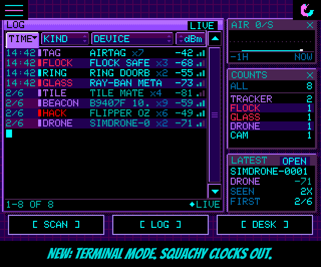

<!-- name: When You're Bored Then You're Boring -->
<!-- board: TERMINAL MODE: a sortable dashboard in Squachy's place | StickS3 and Cardputer ADV: real buttons, real cursor, no more fake finger | Cardputer: keyboard, hotkeys, SD card and GPS wardriving -->
**When You're Bored Then You're Boring.** Boring Mode used to take Squachy away and leave you a black screen and a detector. Honest, but a bit grim. It has been to night school. It's TERMINAL MODE now: a little desktop of windows where Squachy used to stand, with a LOG you can sort, an AIR graph, COUNTS by kind and the LATEST catch. Squachy has clocked out for the shift and left a note. "I'm not gone. I'm in the server room. Don't touch the blinky one."

**Sort it.** The LOG's headings are buttons now. Tap TIME, KIND, DEVICE or dBm to sort by it, and tap it again to flip it. The one in charge lights up and drops into its column, and the rows ripple back in so you can see they moved. TIME the normal way round is the live log, newest at the bottom, LIVE in the corner. Any other order says SORTED, and the footer says what it did: BY KIND, A-Z, CLOSEST UP. Every line shows how many times that device has been seen (x7), because the log already keeps one line per device. "Sorted by signal strength. The AirTag is closest. The AirTag is ALWAYS closest. Check your bag."

**Poke it.** Tap a line to pick it, and tap it again, or tap the LATEST window, to get the same WATCH / HUNT / INFO / IGNORE menu as the LOG screen. Close it and you're back in the terminal.

**Every screen.** The 3.5" boards and the Tab5 get bigger LOG text in taller rows. Turn a board upright and nothing goes missing: AIR, COUNTS and LATEST line up underneath the LOG. The watch and the sticks get the LOG on its own. Your old Boring Mode setting carries over, so if it was on, you'll wake up in the terminal.

**Small boards, big glow-up.** thoughtfix rebuilt the StickS3 and Cardputer ADV from the buttons up. Until now they were running a touch screen interface with a pretend finger, which is about as dignified as it sounds. Now they have their own controls, and the whole button under the cursor lights up and shimmers. Every screen has real cursor stops, long lists scroll and loop, and BACK actually goes back. The StickS3 turns into a keychain: knock the case to poke Squachy, shake it to toss him, wiggle it to wake the screen, and FOB MODE for big Squachy and nothing else. The Cardputer gets real typing on its keyboard, letter hotkeys on every screen, sound, its SD card, the add-on EXT screen done properly, and GPS wardriving with an M5Stack Unit GPS on the Grove port. It was road-tested for 26,623 rows. Squachy is impressed and a little carsick. Everything is written up in docs/SMALL-BOARDS.md and docs/CARDPUTER-HOTKEYS.md. And the Terminal Mode sort buttons light up under that new cursor too, so the sticks can sort as well.

**Thanks.** Huge thanks to thoughtfix for PR #128: four thousand lines, two Cardputers, one StickS3, a drive, and an overnight run on the GPS. "They gave my tiny friends real buttons. I would give them my lucky rock, but I've hidden it from myself."

### The actually-useful part

**Added**
- TERMINAL MODE (SETTINGS > BEHAVIOR, where BORING MODE was): a windowed dashboard in place of the scene. LOG (drag, arrows or track to scroll; NOW / N NEW pill; LIVE / PAUSED / SORTED), AIR (the busiest second of each of the last 60 minutes), COUNTS (log rows per kind), LATEST.
- Sortable LOG: TIME, KIND, DEVICE and dBm heading buttons; tap again to flip; lit heading tabs into its column; rows ripple back in after a sort; footer names the order; xN seen count on every line.
- Tap a picked line again, or LATEST (OPEN), for the WATCH / HUNT / INFO / IGNORE / CANCEL panel; closing it returns to the terminal.
- Bigger LOG text (16 px font, taller rows) on panels 480 px wide or more: 3.5" boards and the Tab5. Upright screens put AIR, COUNTS and LATEST in a row under the LOG.
- StickS3 and Cardputer ADV: cursor stops on the terminal's headings, rows, arrows and LATEST.
- StickS3 and Cardputer ADV overhaul (PR #128 by thoughtfix): one button scheme, whole-button highlight, real cursor stops on every screen, lists that scroll and loop, PRESS wording. StickS3: knock / shake / wiggle (BMI270), FOB MODE, speaker, POWER SAVER on by default. Cardputer: keyboard typing, ESC back / hold for home / opens the menu, letter hotkeys, ES8311 tones, SD card, EXT screen (XL mod ILI9341) handling, Grove GPS wardriving with a WARDRIVE tag, WARDRIVE SOUND and gps-status.log. Dev envs sticks3-dev and cardputer-adv-dev with console key presses and screen dumps.
- Console: GPS RAW echoes the GPS module's sentences for 4 s on GPS boards.
- Emulator: SQUACHSIM_TERMINAL and SQUACHSIM_TMSORT render the terminal at any panel size.

**Changed**
- BORING MODE is now TERMINAL MODE. Same setting underneath, so boards that had it on start in the terminal.
- StickS3: SECURITY / PIN, typing screens and CALIBRATE TOUCH are hidden (no keyboard, no touch panel). C1iPPY is a PET choice there, off by default.
- Web emulator: on the Cardputer, Esc is BACK, and the help text says so.

**Fixed**
- 240x135 layouts (PR #128): raw scan results behind Squachy, long LOG type labels running into names, HUNT bubble over the gauge, SQUAD actions and MESSAGE lines below the screen, CHARGE MODE text off the edge, DESK and SCAN presses lost under Squachy's tap box.
- Cardputer: the SD card was never mounted; the time zone card's buttons could not be reached; the EXT screen froze on its last frame when turned off and kept drawing under POWER SAVER.
