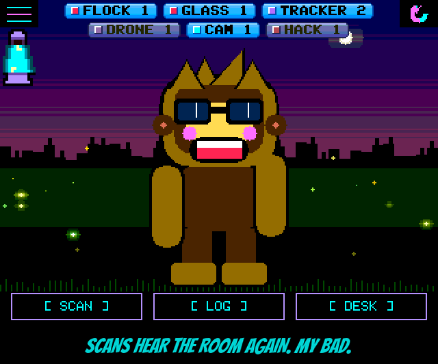

<!-- name: Unbreaking Bad -->
<!-- board: Fixed: WiFi and Bluetooth scans that found nothing on some boards since 1.42.0 | Phone labels and phone hunts that survive an ID change | Terminal Mode battery, LAVA LAMP switch, NM-CYD-C5 update crash -->
**Unbreaking Bad.** Squachy has been told to say sorry, so here it is, in his words: "The boss broke the scanner. I watched it happen. I said nothing. I am also sorry. Mostly about the saying nothing."

**My bad, plainly.** In 1.42.0 I broke WiFi and Bluetooth scanning on some boards. Human Sensing went into every build, and it held on to about 8 KB of memory all the time, even on boards where nobody ever opened it. On boards that were already tight on memory (some CYDs, the AWOK) that was enough to leave the radios deaf: manual scans found nothing, and maybe one boot in twenty worked. This release gives that memory back. Human Sensing now borrows it only while its screen is open and hands it back when you leave. If your board went quiet after 1.42.0, this is the update for you. Thank you to AxisteGraff for #135, to the Discord crew who said the same thing, and to MisterLotto, whose memory numbers in #119 pointed straight at it.

**Phones get a best guess.** Most phones don't broadcast a name, so in SCAN > BLE they were one more "(unnamed)" in a crowd of gadgets. Now an unnamed device is labelled from what its broadcast says it is: (iPhone?), (Android?), (Samsung?), (AirPods?), or plain (Apple). The question marks are honest: an iPad or a Mac in use looks a lot like an iPhone. And no, "Dave's iPhone" will never show up there, because iPhones keep their name off Bluetooth. "I tried asking it. It said nothing. Rude."

**Hunt a phone that won't sit still.** Phones change their Bluetooth address every 15 minutes or so, on purpose, and a hunt follows one address, so it used to go quiet for good. Now, hunting something SCAN labelled as a phone, the board notices when it goes quiet and a new address of the same kind turns up at about the same strength, and asks: IT WENT QUIET. Follow it? YES carries the hunt on with its readings, NO forgets that one. It's a guess, so it always asks. BACK and ESC answer no. "It put on a fake moustache. I still know it's you, phone."

**Terminal Mode got a battery.** The lava lamp used to sit on top of the LOG window. Now the battery lives in the LOG's title bar: four bars and a percentage, green CHG on the cable, red under 20%. And Squachy is back on the boot screen with Terminal Mode on. He clocks out after that, but he likes to say hi on the way in.

**LAVA LAMP: OFF.** Settings > APPEARANCE has a switch for the home screen's battery lamp, on boards that have a battery. Thanks to PA9MWO for asking in #132 (and for building it in their own fork first).

**NM-CYD-C5 updates over WiFi.** Every WiFi update on the NM-CYD-C5 restarted the board at "looking for WiFi". The update asked for a second processor core, and the C5 only has one. Now it asks for the one it has. Thanks to Thosch42 for the crash log in #121. "One core. Like me. One brain cell, fully committed."

### The actually-useful part

**Added**
- SCAN > BLE: unnamed devices labelled from their broadcast: (iPhone?) for Apple Nearby Info / Handoff, (AirPods?) for proximity pairing, (Apple) for other Apple, (Android?) for Google Nearby / Quick Share (0xFEF3), (Samsung?) for Samsung's company ID. The label carries into WATCH and HUNT. Privacy Mode leaves it alone (it's ours, not the owner's).
- HUNT: a phone picked from SCAN that changes its Bluetooth address is offered back. After 10 s quiet (up to 10 minutes), an address of the same kind first heard as the target went quiet, within 15 dB, gets IT WENT QUIET ... Follow it? with NO (where BACK is) and YES. NO is not asked again that hunt. Cardputer: N and Y.
- TERMINAL MODE: the battery in the LOG title bar (bars, percentage, CHG, red under 20%); the lava lamp is hidden there.
- Settings > APPEARANCE > LAVA LAMP ON/OFF, on boards with a battery (#132).
- Emulator: the BLE scan shows a room of labelled devices; `hunt --pose 2` shows the ID-change question.

**Changed**
- The boot screen shows Squachy with TERMINAL MODE on, too.
- HUMAN SENSING takes its ~8.5 KB of buffers from the heap when its screen opens and frees them when it closes (fixed RAM for it: 8.4 KB down to 0.3 KB).

**Fixed**
- WiFi and Bluetooth scans finding nothing on most boots on some boards since 1.42.0: Human Sensing's buffers held ~8 KB of RAM on every ESP32/S3 board whether it was used or not (#135). Should also leave more room for the manual update check on the 2.8" ILI9341 (#119).
- NM-CYD-C5: every WiFi update crashed the board; the update and sound tasks asked for a core the C5 doesn't have (#121).
