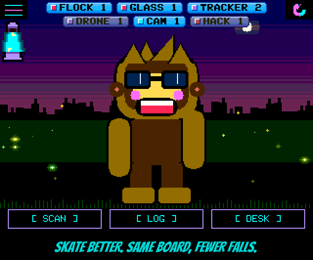

<!-- name: Skate Better -->
<!-- board: More free memory on every board (about 9 KB on the 2.8" CYD) | Missed alerts, repeat alerts and deauth floods fixed | Security fixes for LoRa, updates, the PIN and the squad -->
**Skate Better.** No new tricks this time. We went back over the fundamentals, found every spot where we kept eating pavement, and fixed it. Squachy: "I had the knee pads on the whole time. Mostly."

**We pentested ourselves.** For once the review was pointed at our own code instead of everyone else's gear. It found things. One malformed MeshCore message could crash a LoRa board. A fake update, correctly refused, could still be booted later from SWITCH TO. A forged squad invite could make your board quietly ignore a squad mate forever. The duress wipe left your LoRa keys behind. Pressing reset unlocked a PIN-locked board. All fixed. "I checked under the bed too. There was a bug under the bed."

**Every catch gets its alert.** A catch only alerted if the board noticed it within a fifth of a second. With POWER SAVER on, or after one slow moment, it landed in the LOG with no card, no sound and no squad heads-up. Now each catch is announced once, whenever the board gets to it. Coming back from NEARBY or a WiFi scan no longer re-alerts everything that never left the room, either. "I used to blink and miss things. Now I just blink."

**Deauth floods don't sneak past.** A tool that knocks everyone off by pretending to be every network at once used to slip under the per-sender count. A burst of broadcast deauths from any mix of senders now counts too, and the alert banner finally says DEAUTH FLOOD instead of UNKNOWN. Tested against a real flood on the bench: caught.

**Lighter on its feet.** The 2.8" CYD starts with about 9 KB more free memory than 1.44.0, the same kind of memory whose loss broke scanning in 1.42.0. The backgrounds share one block instead of keeping eight, Bluetooth scanning stopped grabbing memory for every device it hears, and the LOG and SD logging stopped holding big chunks. The firmware is 30 to 58 KB smaller too. "I've been working out. Mostly by putting things down."

**Small stuff.** TERMINAL MODE switches on with one tap, no lecture. POWER SAVER no longer misses a quick tap. POCKET MODE stops drawing frames nobody can see. The T-Watch's touch reads faster. A phone hunt in a busy room no longer offers you a stranger's phone. Drone MORE INFO only shows the drone you tapped.

### The actually-useful part

**Added**
- DEAUTH: 24 broadcast deauth/disassociation frames in 3 s from any mix of senders also fire, beside the per-sender 12 (or 6 broadcast) rule.

**Changed**
- TERMINAL MODE has no confirmation panel; its greyed Squachy rows read "terminal".
- LOCK AT BOOT turns on when a first PIN is set.
- The duress/forgot-PIN wipe also erases the LoRa DM keys and contacts, the LoRa names, and the list of devices seen on several days.
- Fixed RAM down on every board: the backgrounds share one 1.5 KB state block (was 7.7 KB), the info panel's text rows share one block, C1iPPY's grid is packed, and a bench console buffer moved to the heap. The Arduino core's own error log lines are compiled out (CORE_DEBUG_LEVEL 0): 30 KB smaller on the 2.8", 33 KB on the T-Deck, 58 KB on the NM-CYD-C5.
- Bluetooth adverts are read in place: no per-advert string copies on the Bluetooth task.
- The LOG's index is freed when the LOG closes and rebuilt at most every 3 s; SD rows are written without a 4 KB buffer; FIRE, DIGITAL and TERMINAL let go of their memory on UPDATE and HUMAN SENSING.
- The lifetime count, pet taps and background taps are saved less often (the lifetime count once a minute, and before an update restart).
- No frame is sent while the backlight is off (POCKET MODE, DIM LEVEL 0). The T-Watch's touch bus runs at 400 kHz.

**Fixed**
- Alerts lost when the screen did not look within 200 ms of the catch (POWER SAVER, slow passes).
- Every device still in the room re-alerting after more than a minute on NEARBY, a WiFi scan or a cancelled update.
- The low-memory safety check paused while NEARBY was open.
- Two catches at the same moment could overwrite each other in the log.
- The scan could stick in its quiet mode for 25 days after one low-memory moment.
- Phone hunt: a bystander's phone offered as "it changed its ID" once more than 32 phones had been heard; a NO asked again.
- Drone MORE INFO showing another drone's Remote ID details.
- The DEAUTH alert's banner read UNKNOWN; deauth alerts were held off for the first 15 s after boot; a flood across five or more spoofed senders went uncounted.
- MeshCore group texts, MeshCore DMs and LoRaWAN payloads longer than the decrypt buffer overflowed it (LoRa boards).
- A refused update stayed in the spare slot under the old version's name, bootable from SWITCH TO; images with no version marker are refused as older.
- A squad board's message counter restarting at 0 after a wipe (squad mates dropped its messages); forged invite frames writing the replay table.
- Saved LoRa DM keys and MeshCore contacts could be pushed out by a flood of new nodes after a restart.
- POWER SAVER could miss a quick tap between idle frames.
- Terminal Mode re-sorted the whole log every frame.
