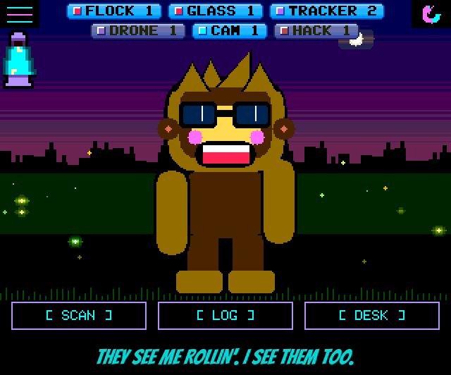

<!-- name: They See Me Rollin -->
<!-- board: MY ALERTS: alert on WiFi names you choose | T-Deck trackball and an Australian LoRa band | WiFi updates fixed on the C5, Marauder V8, 3.2" and Freenove 3.5" -->
**They See Me Rollin.** The T-Deck got a ball to roll, your board learned to watch for names you pick, and a stack of things that tripped people up got fixed. Squachy: "I'm not saying I'm being followed. I'm saying I now get a card about it."

**MY ALERTS.** Settings > MY ALERTS holds up to eight WiFi names of your own to watch for, each with an optional label for the alert card. Plain text catches names that start with it. `*` stands for anything and `?` for one character, so `veh9*` catches `veh912`. It was asked for by a tester on Discord whose local patrol cars run in-car routers named `veh` plus the unit number. A match is a full alert with its own card, colour and counter. It never leaves your board, and a duress wipe clears the list. Anyone can name a router anything, so a match means the name matched, not who owns it. "I don't judge. I just read name tags."

**LoRaWAN operators.** Set LISTEN to LORAWAN on a LoRa board and it names whose network is around: a utility's meters, a city's sensors, The Things Network. That's one alert per operator, not one per meter, so a street of three hundred meters stays one fact. Thanks to boberbyte, who built and tested it in the EU (PR #138). The same PR lifts the EU mesh transmit limit from 14 to 22 dBm, which is what the 869.4-869.65 MHz slot allows. The LORA screen still reminds you about the 10% duty cycle.

**The T-Deck rolls.** The trackball finally does something. Roll it to move a highlight between buttons, press it to press, and Backspace goes back. Touch the screen and the highlight gets out of the way. Thanks to Villu (PR #142), who also added Meshtastic's NarrowFast preset to the EU plan for Norway's mesh (PR #141). "Ball control. Finally something I'm good at."

**LoRa down under.** Australia and New Zealand get their own band plan, AU 915: Meshtastic's Australian slots, MeshCore's Australian presets and LoRaWAN AU915. It's picked from the Australian and New Zealand time zones, or set in LORA SETTINGS > REGION. Thanks to AxisteGraff for the preset list (#129).

**WiFi updates that actually arrive.** The NM-CYD-C5 and the Marauder V8 found their update but never its signature, so every WiFi update stopped (#121). Some 3.2" capacitive boards join WiFi, then hear nothing for up to a minute. The update check now keeps trying for 90 seconds instead of giving up (#85). The Freenove 3.5" no longer turns its update screen into static (#136). We watched full downloads go through on the 2.8", the 3.2" and the 3.5". "I used to give up after twenty seconds. Now I give up after ninety. Growth."

**AWOK love.** Human Sensing has an upright layout, so it stops telling a board with no tilt sensor to turn sideways (#133). And scrolling stopped picking things at random: the touch screen kept briefly losing your finger mid-drag, and each time it came back counted as a fresh tap (#134). We don't have an AWOK to test on, so tell us how it feels.

**Small stuff.** HUNT stopped piling old speech bubbles along its top edge (#77). The charge screen's note fits on upright screens (PR #137 by MisterLotto). The memory checks on boards with extra memory now look at the right kind (PR #115 by at0m-b0mb). The 22 dBm LoRa setting survives a restart. For tinkerers: a GPS build for the Freenove 3.5" (`freenove-s3-35-gps`, PR #126 by bobsdinner-cell) and an RL Phantom 2.4" build for the panel batch with a noise band along the bottom (`rlphantom-r-alt`, #88). Both are build-it-yourself for now.

### The actually-useful part

**Added**
- MY ALERTS (Settings > BEHAVIOR): up to 8 WiFi name patterns with optional 15-character labels; plain text is a prefix, `*` and `?` make a whole-name glob, case-insensitive; under 2 fixed characters is refused, under 3 warns. Matches are type MY ALERT (high confidence), outside the DEX, BINGO and TYPE FILTER; while the list is in use it takes the 12th counter and beacons fold into TRACKER. Stored on the board only; cleared by the duress wipe.
- LORAWAN detection type on LoRa boards: LISTEN > LORAWAN names the network operator from the DevAddr's NetID (LoRa Alliance registry); one alert per operator, again after an hour unheard; LWAN counter tile and DEX card (PR #138 by boberbyte).
- T-Deck Plus trackball: roll steps a highlight cursor, press presses, Backspace is BACK off text screens, the highlight hides after 15 s or on touch; console `TBALL` (PR #142 by Villu).
- LoRa band plan AU 915 (Australia, New Zealand): Meshtastic ANZ slots, MeshCore Australia Mid/Narrow/Wide/SA-WA-QLD/Legacy, LoRaWAN AU915 sub-band 2; picked from the AUS/QUEENSLAND/DARWIN/NEW ZEALAND zones; LORA SETTINGS > REGION and `LORA REGION AU`.
- Meshtastic NarrowFast (869.442 MHz, SF7, 62.5 kHz) on the EU plan (PR #141 by Villu).
- LoRa TX: a 22 dBm step; the EU mesh ceiling is 22 dBm (was 14) (PR #138).
- Build-only targets: `freenove-s3-35-gps` (PR #126 by bobsdinner-cell) and `rlphantom-r-alt` (ILI9341_2 init plus inversion, #88).

**Changed**
- WiFi update, manual check: no connection or no reply is retried until 90 s after the join, on a 6 s fuse, asking the name again each time; the boot check is unchanged.
- WiFi update: boards with PSRAM keep their frame buffer through the download.
- Heap-pressure checks measure internal RAM (PR #115 by at0m-b0mb).
- Human Sensing has a 240x320 upright layout.

**Fixed**
- NM-CYD-C5 and Marauder V8 WiFi updates: their signatures were never published, so every update stopped on HTTP 404 (#121).
- 3.2" capacitive: WiFi updates giving up while the board could not yet reach the network after joining (#85).
- Freenove 3.5": noise on the update screen during a WiFi update (#136).
- AWOK: Human Sensing asked to turn the board sideways (#133); drags turned into taps when a touch read briefly dropped out (#134).
- HUNT: speech bubble edges piling up in the top band (#77).
- CHARGE MODE: the note ran off both edges of an upright screen (PR #137 by MisterLotto).
- LoRa TX 22 dBm reset to OFF at every restart.
