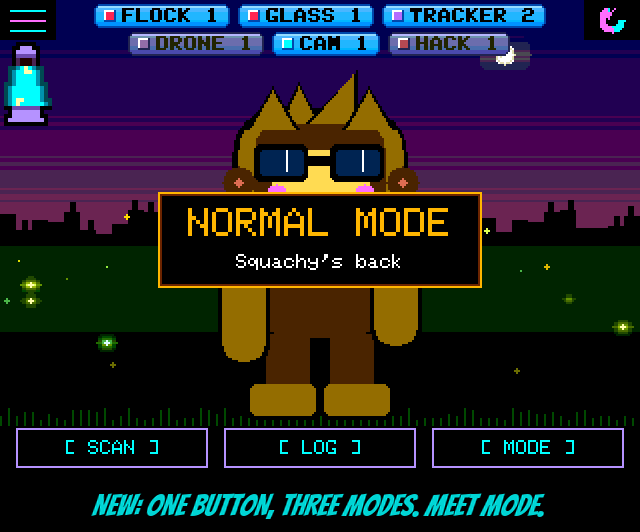

<!-- name: You Break it You Bought It -->
<!-- board: MODE: Squachy, the desk or TERMINAL MODE in one tap | Mothman is loose in the fireflies | The M5Stack Tab5 joins the flasher and fixes its own radio -->
**You Break it You Bought It.** One button now does three jobs, a moth with opinions moved into the treeline, and the Tab5 learned to fix its own radio so you don't have to. Squachy: "I only touched it a little. It's mine now."

**MODE.** The third button on the main screen is now MODE, and it steps through three ways to use the same detector. Once: the desk clock. Twice: TERMINAL MODE. Three times: Squachy's back. Each tap says where you landed. Detection never changes, only the screen. On the StickS3 that button stays FOB. "I'm not offended. I'm on a break."

**TERMINAL MODE, front and centre.** Plenty of you want the tool and not the mascot, and that's fine. TERMINAL MODE is a desktop of windows: a LOG you can sort by time, kind, device or signal, an AIR graph of how busy the airwaves are, COUNTS by kind, and the LATEST catch, with WATCH, HUNT, INFO and IGNORE a tap away. It now has its own section at the top of the README, and Squachy mentions it on first boot. He's taking it well. Mostly.

**Mothman.** Something with red eyes is watching from the FIREFLIES treeline. Find him and he joins you as a pet, brings two outfits (MOTH HOOD and RED WINGS), and starts a new **Cryptid Field Guide** in Settings. How to find him is between you and the treeline. Thanks to infyrno1010101, who made him (PR #131). "He doesn't blink. I asked."

**The Tab5 is on the flasher.** The M5Stack Tab5's WiFi and Bluetooth live on a second chip that needs our firmware. Until now that meant a separate tool. Now SquachWatch carries the radio firmware itself: on first boot it offers a one-time RADIO UPDATE, takes about 15 seconds, restarts, and the Tab5 hears the room. Keep it plugged in for those seconds. It's BETA: proven on our bench, but no Tab5 straight from the box has been through it yet, so tell us how yours goes.

**A bigger desk.** The desk clock has an X-LARGE size, and a new DESK ALERT setting decides what a catch does while you're at your desk: the small card, a BIG CARD over most of the screen, or the FULL SCREEN alert. Thanks to GreyFox01 (PR #112). Settings > DESK MODE is now DESK SETTINGS, since MODE is the way in.

**Small stuff.** On the T-Deck, SHIFT+$ types "=" (handy for LoRa channel keys), a message with a line break no longer spills over the chat rows, and the LORA page's LIVE tag stops clipping the title. Thanks to shadowlab (PR #103). The docs got a full going-over: every feature is written down somewhere, two dozen stale facts are fixed, and the README now has hints for the hidden outfits and pets, by release. No spoilers. Mostly.

### The actually-useful part

**Added**
- MODE (third button on the main screen): normal → desk → TERMINAL MODE → normal, with a DESK MODE / TERMINAL MODE / NORMAL MODE card on each step; the desk's bottom-right button is MODE (on to TERMINAL MODE). The StickS3 keeps FOB and its Settings > TERMINAL MODE row.
- Mothman: red eyes in the FIREFLIES treeline; the MOTHMAN pet, MOTH HOOD and RED WINGS outfits (outfits 20 and 21), and the Cryptid Field Guide (Settings, after SQUACHY-DEX) (PR #131 by infyrno1010101; its E32R28T speaker code is not included).
- Tab5: the app carries the C6 radio image (ESP-Hosted 2.12.13 + the sniff extension) and, when the radio links but does not answer the sniff hello, offers RADIO UPDATE on boot (ESP-Hosted slave OTA; at most two tries without a good hello). The Tab5 is on the public flasher (BETA).
- Desk: CLOCK SIZE X-LARGE; DESK ALERT = CARD / BIG CARD / FULL SCREEN on the desk's page (PR #112 by GreyFox01).
- First-boot walkthrough: a line explaining MODE and TERMINAL MODE.
- README: a "Three modes" section with the three screens side by side, and "Hints for the hidden ones".

**Changed**
- Settings: the TERMINAL MODE row is gone except on the StickS3; DESK MODE is DESK SETTINGS and its OPEN row is gone.
- T-Deck: SHIFT+$ types "=" and unmapped key bytes are logged (PR #103 by shadowlab).
- Docs: every feature documented; GPS and LoRa boards, sound, what goes out over the air, LoRa TX steps and the EU cap, BOOT power-off (Freenove 3.5" only), and 20-odd other facts corrected.

**Fixed**
- LoRa chats: control characters in a received message (a line break) printed as cursor moves and spilled over the rows below (from PR #103).
- LORA page: the LIVE tag overlapped a long title (PR #103 by shadowlab).
- Desk FULL SCREEN alerts counted each catch twice, and a tap on the BIG CARD could mark a hidden squad message read instead of opening the alert (fixed while merging PR #112).
- Mothman's RED WINGS beat so far they hid behind him (fixed while porting PR #131).
