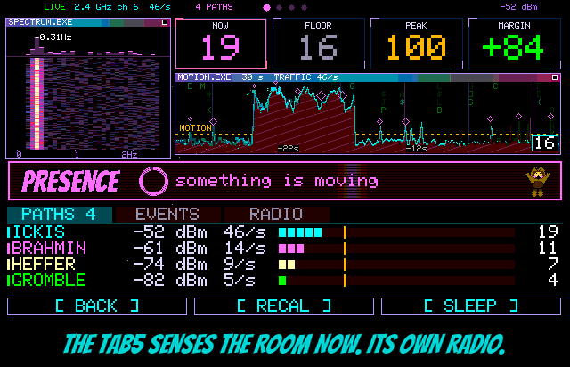

<!-- name: Every Breath You Take -->
<!-- board: HUMAN SENSING grows SCOPE, SNEAK and VITALS | The Tab5 senses the room with its own radio | BACK, RECAL, SLEEP on every board -->
**Every Breath You Take.** HUMAN SENSING got three new pages, the Tab5 learned to sense the room with its own radio, and VITALS now counts your breaths from the WiFi between you and your router. Squachy: "Hold still. No, stiller. I can hear you breathing. Literally."

**Three new pages.** On the boards with room for them (the Freenove S3 3.5in and 2.8in, the T-Deck Plus and the Tab5), HUMAN SENSING is four pages now. Swipe to turn them, or press , and . on the T-Deck. **SCOPE** is a radar of the WiFi paths around the board: your router plus the busiest transmitters nearby, each one lighting up as something crosses it. **SNEAK** is a game: START RUN, cross the room, don't trip the sensor. LEVEL decides how sneaky you have to be. **VITALS** wants you to sit still between the board and the router, then reads your breathing from the signal: breaths a minute, a waterfall of the rhythm, a breath loop and a log of the session. It's a toy, not a doctor. All three wear an **EXPERIMENTAL** tag: plain motion is solid, but reading more than that out of one router's signal is new ground, and it can get it wrong. "I'm not a doctor. I'm barely a Squachy."

**The Tab5 senses now.** Its ESP32-C6 radio joins your saved network, pings the router fifty times a second and watches the signal, the same way the other boards do. All four pages are there, in the Tab5's own big layout, and VITALS does its 20-second sums on the Tab5's main chip. If your Tab5's radio is still on v1.47.0's firmware, opening HUMAN SENSING offers a one-time RADIO UPDATE first (about a minute, then a restart; keep it plugged in). ADD A NETWORK on the Tab5 actually scans now, too, instead of saying NO NETWORKS FOUND to a room full of them. "It was looking. It just wasn't seeing."

**One set of buttons.** Every board's sensing screen has the same three: **BACK**, **RECAL** and **SLEEP**. SLEEP turns the screen off and keeps sensing; a tap or a key wakes it. On SNEAK the middle and right buttons are START RUN and LEVEL, and on VITALS the middle one is NEW SESSION. The board remembers which page you were on, across a restart too.

### The actually-useful part

**Added**
- HUMAN SENSING: SCOPE, SNEAK and VITALS pages (tagged EXPERIMENTAL at the top of the screen) on the Freenove S3 3.5in, Freenove S3 2.8in, T-Deck Plus and Tab5; page dots in the title; swipe, or , and . on the T-Deck (ENTER and L on SNEAK, N on VITALS).
- Tab5: HUMAN SENSING on its own C6 (joins the saved network over ESP-Hosted, pings the router 50/s, router held as the first path, VITALS fitted on the P4; SPECTRUM.EXE, the PATHS / EVENTS / RADIO panel, SCOPE's radar, SNEAK's high scores, the full VITALS).
- Tab5: a RADIO UPDATE offer when HUMAN SENSING opens on a radio without the sensing extension (new C6 image, hello "squach-sniff 2").
- The sensing page is saved (Settings, "sensePg") and comes back after a restart.
- Emulator: `sim/build_tab5_sim.sh` builds `squachsim-tab5`, which draws the Tab5's own sensing pages (SQUACHSIM_PAGE=0..3).

**Changed**
- Sensing buttons are BACK / RECAL / SLEEP everywhere (SNEAK: BACK / START RUN / LEVEL; VITALS: BACK / NEW SESSION / SLEEP). OFF is now SLEEP; O on the T-Deck still hands the radio straight back to the detector.

**Fixed**
- Tab5: ADD A NETWORK found no networks (the WiFi scan was a stub); it scans over the C6 now.
- Tab5: saved WiFi networks were not kept; they are saved in the settings store now.
