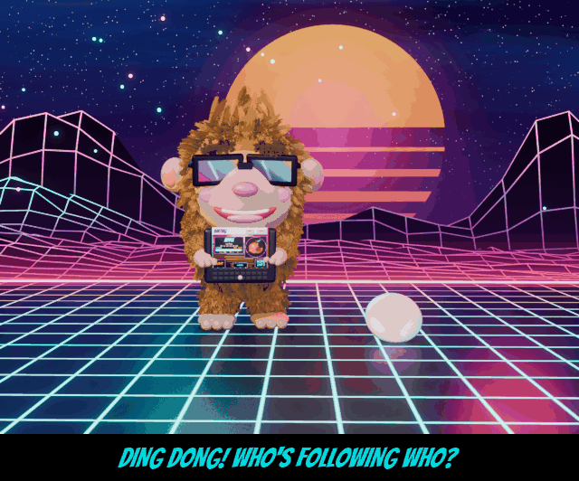

<!-- name: Ring Ding Dong -->
<!-- board: RING: make a tracker that follows you beep | T-Deck POCKET MODE on the trackball | TERMINAL MODE rests between catches -->
**Ring Ding Dong.** Your watch can knock on a tracker's door now. Spot an AirTag, a Samsung tag, a Google tag or a Tile that's been tagging along, press RING, and make it give itself away. Squachy: "Ding dong. Who's there? Exactly. That's what I'd like to know."

**RING.** A tracker alert (AirTag, Samsung, Google or Tile) has a **RING** button now, and a tracker's long-press panel in LOG has a **RING IT** row. The watch stops scanning for a few seconds, connects to the tracker and asks it to play its sound, then tells you how it went: **RINGING** (listen for a beep), **NO ANSWER**, **NO SOUND** or **IT SAID NO**. The screen keeps going the whole time and scanning picks up again after. One catch, and it's on purpose: trackers only beep for strangers while they're away from their owner's phone. That's the anti-stalking design working, so a tracker sitting next to its owner will usually say no. "It's not rude. It's just loyal." RING is on the S3 boards and the C5 boards; the CYDs don't have the room for it. Thanks to **JBoHack** and **Hedge** for the idea.

**T-Deck POCKET MODE.** Hold the trackball down for 2 seconds and the screen goes dark while the watch keeps scanning, the same POCKET MODE the watches have. Press the trackball to wake it. "Lights out. Ears on."

**Whole sentences.** The little message boxes cut their second line off at 21 letters, so "Press the trackball to wake" came out as "Press the trackball t", and plenty of others ("Detector paused while this is open", "Turn TRANSMIT on in SquachMesh") lost their endings too. They get the whole line now, trimmed only where a small screen really can't fit it. "I had a lot more to say. I always do."

**TERMINAL MODE rests.** Leave TERMINAL MODE alone for 3 seconds and it redraws 4 times a second instead of flat out; after 30 seconds, twice a second, with the processor slowed down too. Scanning doesn't lose a thing, and any touch, key, trackball nudge or new catch brings it straight back to full speed. Not on the Tab5 or the 7in CrowPanel. "Resting my eyes. Not my ears."

### The actually-useful part

**Added**
- RING on tracker alerts (AirTag, Samsung, Google, Tile) and a RING IT row on a tracker's LOG long-press panel: connects for a few seconds and tries AirTag's sound command, then DULT, then Find My (command bytes as AirGuard documents them); a toast reports RINGING / NO ANSWER / NO SOUND / IT SAID NO. S3 and C5 boards only. Idea: JBoHack and Hedge.
- Console: `RING` rings the tracker heard most recently; `RING NAME <text>` rings the next connectable device with that in its name (`squachwatch` and `meshtastic` match by service), for testing a connection against something known to answer.
- T-Deck Plus: POCKET MODE on the trackball (hold 2 s, press to wake).
- Emulator: RING on the web T-Deck, T-Watch and Cardputer (the tracker always answers there); `sim/build_ring_sim.sh` builds `squachsim-ring`.

**Changed**
- TERMINAL MODE rests after 3 s untouched (4 redraws a second, 2 after 30 s, CPU at 80 MHz); radio work still runs every 20 ms. Not on the Tab5 or CrowPanel 7.
- The S3 and C5 builds allow 5 Bluetooth connections in NimBLE's tables (RING still opens one); with 1, the S3's controller handed out connection handle 2 and NimBLE wrote past its per-connection tables, crashing the Bluetooth host right after connecting.

**Fixed**
- Toasts cut their second line at 21 characters and their title at 17 (POCKET MODE's "Press the trackball to wake", HUMAN SENSING's "Detector paused while this is open", the SquachMesh CAN'T SEND reasons and more); both buffers are longer now, and a line too wide for a small panel is trimmed to the box.
