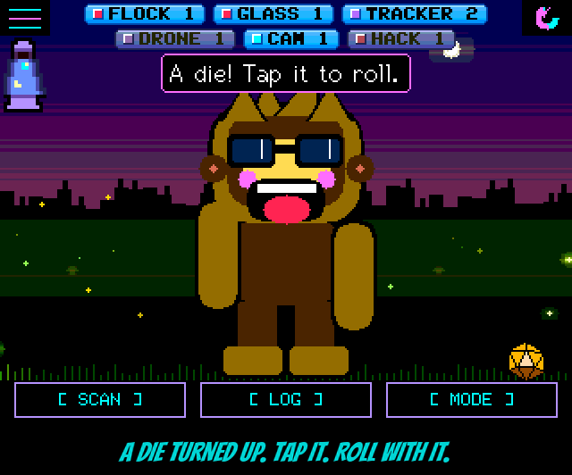

<!-- name: Roll With It -->
<!-- board: Random encounters: roll the die, fill the FIELD JOURNAL | The Trail card: who's been following you, and where | Eleven alert card skins | Wardriving page and WiGLE upload | Smart speakers, dashcams and goblins -->
**Roll With It.** Squachy rolls dice now. Every so often a gold d20 drops at his feet, and whatever it rolls turns up on the screen: a stranger Squachy dropping out of a hole in the sky, a goblin, a giant Mothman over the horizon, a UFO, or, if the dice really love you, the Elder. "I don't make the rules. The d20 makes the rules. I just live here."

**Random encounters.** Nine of them, in four rarities, and the board rolls its own dice while the main screen is up: about one an hour and a quarter, never more than four hours apart. You always see the roll, so nobody mistakes a made-up visitor for a real SquachWatcher in range. The visitors fall out of a hole in the sky, boot the die off the screen and leave by the same hole. Some rolls come up empty and Squachy scratches his head about it. A 1 bounces off the floor and onto his head. A 20 turns gold, he cheers, and what comes is a shiny: sparkles, a trail, and the Legend's aura. "Natural twenty! Somebody write that down." Somebody does: the **FIELD JOURNAL** (Settings) keeps who turned up, how often, when you first met them, and the shinies. **RANDOM ENCOUNTERS** on the Appearance page turns them down or off.

**The free roll.** One die is waiting for you after the update, and another turns up after every twelve hours the board has been running. It sits on the floor for thirty seconds: tap it and roll. Leave it alone and Squachy might boot it off the edge of the screen for fun. No touch screen? **P** on the T-Deck Plus and the Cardputer, or **FREE ROLL** in the FIELD JOURNAL. And about one time in eight, it isn't a die. "That is NOT a die. I am not touching that again."

**The Trail card.** The alert card got rebuilt around one question: has this thing been following you? It shows the places you've stopped since the device was first heard, with the time at each and the distance between them when the board knows where it is, ticks for why (AWAY from its owner, at EVERY STOP, how many minutes, CLOSER), a ladder of its signal, and a verdict up top: **NEW**, **MET BEFORE**, **FOLLOWING** or **SPAM FLOOD**. Places are worked out from the WiFi around you, so it works without GPS. Catches that land while a card is up queue behind it, and holding a LOG row opens that device's card. AirTags set up with a phone are now seen while they're next to it, and the card says when a tag is away from its owner.

**Alert card skins.** **Settings > APPEARANCE > ALERT CARD** dresses the card up as an operating system window: Sunset 95, System 7, Glass, Amiga, XP, Aqua and Terminal everywhere, plus Neon Desktop, Tiling, BeOS and NeXTSTEP on the S3 boards. They all follow your theme, and there's a new theme to go with them, **DU5K**. "Same tracker. Nicer window."

**Wardriving, finished.** The **WARDRIVE** page shows the GPS, this drive's counts and the file it's writing. The web flasher can now upload your WiGLE files straight from the browser and send your WiGLE key to the board over the cable. The T-Deck Plus and the T-Watch S3 can upload by themselves over your saved WiFi, by hand or whenever they're on the charger.

**New things to find.** A new type, **LISTENER**, for smart speakers with microphones (Sonos, HomePod), off by default like the other household types. Dashcams (BlackVue, 70mai, Thinkware, VIOFO, Nextbase and friends), fleet cameras, the setup hotspots hidden cameras broadcast, patrol-car routers, Rokid and Vuzix glasses, and two more Wyze ranges plus SimpliSafe. And if somebody nearby runs a **Network Goblin Scout**, their goblin walks onto your screen, high-fives Squachy, chats and leaves. Thanks to **MostlyWithinSpec** for the goblin (#37). "He's got a loot sack. I'm not asking."

**Nobody teleports.** Squachy used to jump a quarter of the screen in one frame when a visitor arrived or left, and snapped back after every double-take. He walks it off now.

### The actually-useful part

**Added**
- Random encounters: nine of them in four rarities, rolled on the board every ten minutes of main-screen time (about one every 1¼ hours, never more than 4 hours), a shiny one time in 64; RANDOM ENCOUNTERS (OFF, RARE, NORMAL, OFTEN) on the Appearance page and in the FIELD JOURNAL.
- The roll is shown as a d20 by Squachy's feet: 1-5 nothing, 6-12 COMMON, 13-16 UNCOMMON, 17-18 RARE, 19 LEGENDARY, 20 shiny. Visitors drop from a hole in the sky and kick the die away; one empty roll in four is shown; a 1 bonks him; a 20 turns gold.
- FIELD JOURNAL (Settings): every encounter met, how often, the first date, shinies, and the Elder's photos.
- FREE ROLL: one after the update, then one per 12 hours of running time (counted across restarts). Its die waits 30 seconds on the main screen; tap it, press P (T-Deck Plus, Cardputer ADV), or select FREE ROLL in the FIELD JOURNAL. About one in eight is THE MIMIC, the journal's tenth entry.
- The Trail card: places worked out from nearby WiFi (and GPS where there is one), the stops a device was heard at, verdicts NEW / MET BEFORE / FOLLOWING / SPAM FLOOD, the reasons as ticks, a signal ladder, and an OWNER row for trackers. Up to four catches queue behind an open card.
- Holding a LOG row opens that device's alert card.
- ALERT CARD page (Settings > APPEARANCE): eleven window skins (seven on the classic ESP32 and C5 boards), OPEN WITH ANIMATION and SUNSET BEHIND; the DU5K theme.
- WARDRIVE page: GPS, counts, the file or flash kept. Web flasher: UPLOAD TO WIGLE, and SEND KEY TO MY BOARD. On-board WiGLE upload (by hand or on the charger) on the T-Deck Plus and T-Watch S3. Console: `WIGLEKEY`.
- LISTENER type (off by default): Sonos OUIs, company ID and UUID; HomePod's "Hey Siri" advert; the GoogleHome setup hotspot.
- Signatures: BlackVue, 70mai, Thinkware, Lytx, Samsara (CAMERA); VIOFO, BlackVue, 70mai, Thinkware, Nextbase, Rove, Redtiger and Lytx hotspots; hidden-camera setup hotspots (P2P-Cam IDs, V380, LookCam, HDWifiCam and more); Vantrue; Cradlepoint and Sierra AirLink routers (AXON, low); Rokid and Vuzix (META, low); Wyze F0:C8:8B and 80:48:2C; SimpliSafe F8:51:28. Info pages for the new families.
- Network Goblin Scout visitors (with SquachMesh DETECT on). Idea and protocol: MostlyWithinSpec (#37).
- AirTags: the frame a set-up tag sends beside its phone, and an unpaired tag's frame, are now matched; the owner state (WITH OWNER, AWAY, NOT SET UP) shows on the card. Google Find Hub tags report it too.
- Console: `ENCOUNTER <0-9> [SHINY]`, `ENCOUNTER MISS [1-5]`, `ENCOUNTER FREE`, `ENCOUNTER ROLL`, `ENCOUNTER PLAY`.

**Changed**
- With the unlock-everything hold done, P on the T-Deck Plus and Cardputer ADV plays the dice scenes one after another (they don't count in the journal).
- Sideways jumps faster than Squachy walks are carried and walked off instead of drawn in one frame.

**Fixed**
- Squachy snapped about twenty pixels after every double-take at the default tempo.
- A visitor was drawn on his mark for one frame before walking in.
- AirPods were counted as AirTags.
- The LoRaWAN type icon drew a router under it.
- Old Flock and ShotSpotter text on the info pages.
