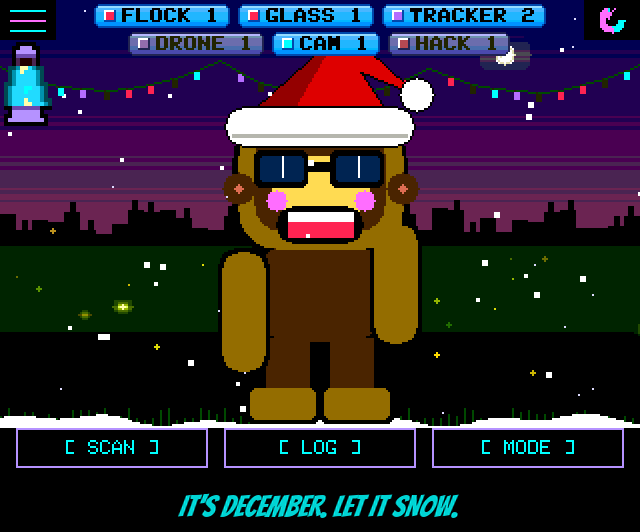

<!-- name: Let It Snow -->
<!-- board: December: snow, lights and a Santa hat on every outfit | SCAN.LOG and a new MORE INFO card | AirTag OWNER on every alert card | The flasher sets the clock for you | Meshtastic AES-256 channels and Turbo presets -->
**Let It Snow.** From December 1 to 26, the main screen snows. Flakes drift behind Squachy and in front of him, a drift piles up along the floor, three strings of lights hang across the top, and he wears a Santa hat. "It's not a costume. It's seasonal camouflage. Totally different."

**The December look.** The bulbs on the lights are the detection colours, and one flares every time the board hears something new, so the tree is also a radar. The hat goes over every outfit, ears and horns poking out round it. The two outfits that already have a hat change theirs instead: YZZERD's wizard hat goes red with white trim and a bobble, and the tinfoil hat turns red foil, propeller and all. "Great galloping garland! Who put a bell on my head?"

**One tap turns it off.** The first time December comes on, a **HOLIDAY MODE!** card asks once a year: **KEEP IT** or **TURN OFF**. **Settings > APPEARANCE > SEASONAL** switches it back on or off any time. BORING MODE stays boring. It goes away by itself on December 27.

**The board knows what day it is.** December needs a date, and a CYD with no WiFi, no GPS and no clock chip didn't have one. The web flasher now sends the board the time and your time zone after every install, as soon as the board reaches its main screen. Keep the page open a moment after it says done. A board that loses power picks up from the last time it knew, and if it gets switched on seven times in a row without hearing the real time again, it stops trusting that guess for December: late snow is fine, snow in January is not.

**SCAN.LOG.** SCAN got a green-screen window. Devices print as they're heard, the address unscrambling before the name types in, with a loudest-three panel and the WiFi channels lighting up as the radio steps across them. The results come up as **RESULTS.LOG**, and holding a result opens its alert card. TERMINAL MODE rows open the alert card too. "I've seen things you wouldn't believe. Most of them were printers."

**A new MORE INFO card.** The INFO page for a detection is now a card in that type's colour: a plain-English headline, a **SURE / LIKELY / MAYBE** pill with WHY it says that, a TIP, and tiles for how often and where you've seen it. On the T-Deck, the 3.5in and the sideways 2.8in it opens inside your alert card skin.

**OWNER on every alert card.** A tracker's OWNER line (WITH OWNER, AWAY, NOT SET UP) now shows on every skin. Before, some skins dropped it when space was tight, and NOT SET UP, the one you most want to see, disappeared entirely.

**From the community.** Meshtastic channels with 32-byte keys (the kind the apps make for a new private channel) now open and send, thanks to **rbales79** (#150). **Bandicoot** added Meshtastic's ShortTurbo, MediumTurbo and LongTurbo presets (#156). **slickrick773** brought the Waveshare ESP32-C5 3.5in touch board, with touch that works without calibration and an LC76G GPS (#83, #161), and **phreakmonkey** added a build for the E32R28T with its battery reading (#157). Those two boards build from source for now. "New friends. I'm keeping the good snacks hidden."

**Tab5.** A Monster C5 plugged into the back now runs HUMAN SENSING, VITALS included, and hears 5 GHz. The rotate button is gone on the Tab5 and the CrowPanel 7in, where it turned the touch map but not the picture, and a board already stuck sideways recovers on update. Its WiFi scan now only listens, like every other board's.

### The actually-useful part

**Added**
- The December look, December 1 to 26 by the board's clock: snow in front of and behind Squachy, a floor drift, three strings of lights in the detection colours (a bulb flares on each new advert), and a Santa hat over every outfit. YZZERD's and TINFOIL's own hats turn red and white instead.
- HOLIDAY MODE card, once a year the first time December comes on: KEEP IT, or TURN OFF.
- SEASONAL (AUTO, OFF) on Settings > APPEARANCE.
- The web flasher sets the board's clock and time zone after every install, once the board reaches its main screen (it did this only for the T-Watch).
- SCAN.LOG while a scan listens and RESULTS.LOG for its results: two-line rows, a summary panel, and holding a result opens its alert card. The TRACK THIS TARGET? panel is gone.
- New MORE INFO card: headline, SURE / LIKELY / MAYBE pill with WHY, the description, a TIP, and SEEN / PLACES / FIRST / FOLLOWING tiles; inside the alert skin on the T-Deck, 3.5in and sideways 2.8in.
- Meshtastic: channels with 32-byte (AES-256) keys open and send (PR #150 by rbales79).
- Meshtastic ShortTurbo, MediumTurbo and LongTurbo presets, on Meshtastic's own US frequencies (PR #156 by Bandicoot).
- Waveshare ESP32-C5-Touch-LCD-3.5 support, ws-c5-35, with touch that needs no calibration, and ws-c5-35-gps for an LC76G on the header's I2C; build from source (PR #83 and PR #161 by slickrick773).
- cyd-e32r28t build with the battery reading on GPIO34; build from source (PR #157 by phreakmonkey).
- Tab5: a Monster C5 on the M5-Bus runs HUMAN SENSING, VITALS and 5 GHz included, with a MONSTER C5 / TAB5 C6 badge on the sensing pages.
- Console: `XMAS 0/1/2` forces the December look until a restart.

**Changed**
- A tracker's OWNER row shows on every alert skin and the Trail card; CONF, then SEEN, then MAC make way when space is short.
- TERMINAL MODE rows open the device's alert card and return to the terminal.
- Reworded explanations for UNKNOWN, FLOCK, AXON, SKIMMER, AIRTAG, DRONE, TILE and RING.
- A guessed clock (a cold boot with nothing to set it) only counts for December for seven power-ons.
- Console lines can be 128 characters long, enough for a 32-byte channel key.

**Fixed**
- NOT SET UP vanished from System 7 and other skins when the card was short on room.
- Tab5 and CrowPanel 7in: the rotate button turned the touch map but not the picture, and the saved rotation kept it that way.
- Tab5: its WiFi scan sent probe requests; it only listens now.
- T-Deck: the LORA pill no longer drops a row when the GPS gets a fix.
