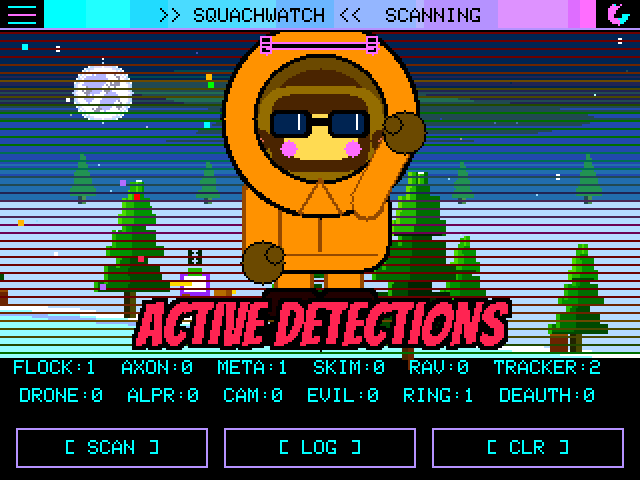
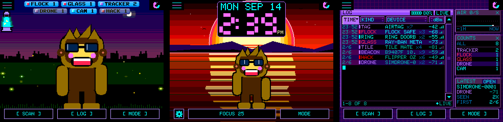
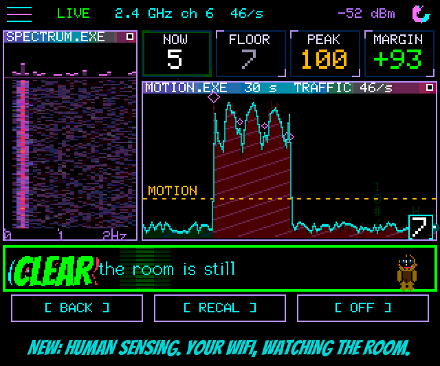
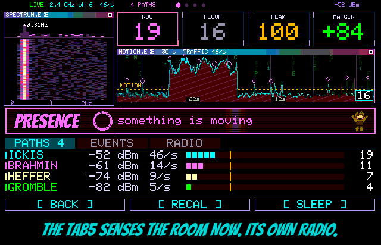
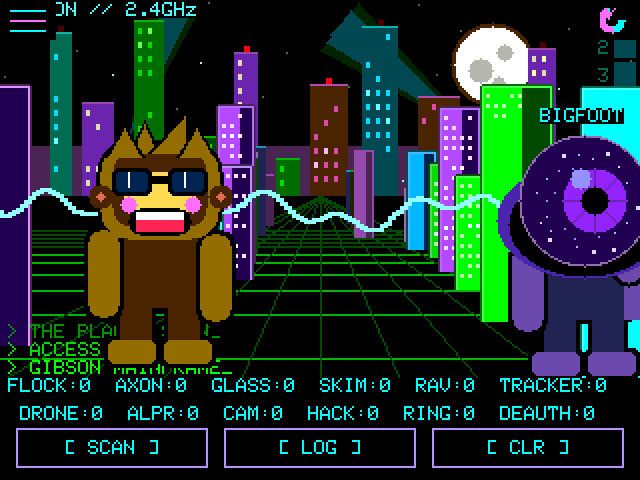
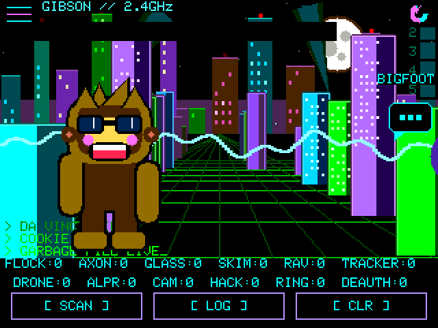
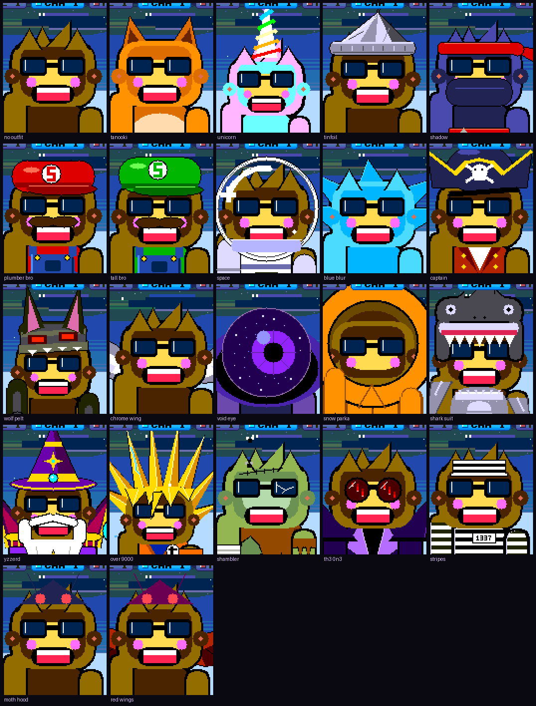

# SquachWatch-CYD

> Surveillance-device detector for the ESP32-2432S028R ("Cheap Yellow Display"), and a growing list of other ESP32 boards.

SquachWatch-CYD sniffs WiFi and Bluetooth for known wireless signatures
of Flock Safety cameras, Axon body cameras, recording glasses, card
skimmers, AirTags, drones, proximity beacons and pentest hardware. On the
2.8" CYD it listens on 2.4 GHz and runs standalone on the bare board — no
PC, no extras, just plug it into USB. A few other boards hear more: the
ESP32-C5 boards scan 5 GHz as well, the T-Watch S3 and the T-Deck Plus listen
to LoRa, and some boards have GPS (see [Boards](#boards)).

The UI is a vaporwave-themed take on the **SquachWare** aesthetic: matrix
digital rain, Squachy the mascot, full-screen dramatic ALERT overlays, and
the glitchy SquachWatch wordmark.

<p align="center">
  <a href="https://squachwatch.com/emulator/" title="Drive it in your browser">
    
  </a>
</p>

<p align="center">
  <b>That is the firmware itself, not a mockup.</b><br>
  Every frame above was rendered by the same C++ that runs on the board,
  compiled for a PC.<br>
  <a href="https://squachwatch.com/emulator/"><b>Click it to drive it in your browser &rarr;</b></a>
</p>

## Three modes: Squachy, the desk, or just the data

<p align="center">
  
</p>

The **MODE** button, bottom right, steps through three ways of using the same
detector. Detection never changes between them; only the screen does.

- **Normal.** Squachy, the counters, the backgrounds and the pets. The fun one.
- **Desk.** A big clock with Squachy under it, a focus timer, and a small card
  when something turns up. Made to sit on a desk all day.
- **TERMINAL MODE.** No mascot, no animation: a desktop of windows built for
  people who want the tool. A **LOG** of every device you can sort by time,
  kind, device or signal (tap a heading, tap again to flip it), an **AIR**
  graph of how busy the airwaves are, **COUNTS** by kind, and the **LATEST**
  catch. Tap a line (or LATEST) for WATCH, HUNT, INFO or IGNORE. Alerts still
  take the full screen. It stays on through restarts until you change it.
  Left alone for 3 seconds it rests: 4 redraws a second, then 2 after 30
  seconds with the processor slowed down. Scanning carries on at full speed,
  and a touch, a key or a new catch wakes it at once. (Not on the Tab5 or
  the 7" CrowPanel.)

From the main screen MODE opens the desk; MODE on the desk goes to TERMINAL
MODE; MODE there brings Squachy back. (On the StickS3 that button is FOB, its
keychain mode, so TERMINAL MODE is a row in its Settings instead.)

## What it detects

| Type | What | How |
|---|---|---|
| `FLOCK` | Flock Safety ALPR cameras | 49 WiFi OUI prefixes + `flock-` and bare `Flock` SSIDs + BLE names (Flock, Penguin, Pigvision, a bare ten-digit battery serial) + company ID `0x09C8` + Flock's own BLE service UUID |
| `AXON` | Axon body cameras, TASERs, LE equipment | 3 WiFi OUI + SSID prefixes `AB2-`/`AB3-`/`AB4-`/`AXON-` |
| `META` | Camera glasses — Ray-Ban Meta, Snap Spectacles | BLE service UUID `0xFD5F` + Meta / Luxottica / Snap company IDs |
| `SKIMMER` | Bluetooth card skimmers (HC-05/06/03, RN42, BT04-A) | BLE advertised-name match + SPP UUID `0x1101` + 3 OUI |
| `RAVEN` | Raven gunshot detector | Any service UUID from `0x3100` to `0x3500` |
| `AIRTAG` | Apple AirTag / Find My trackers | Company ID `0x004C` + Find My payload check |
| `DRONE` | Remote ID drones | Remote ID in a BLE advert's service data (`0xFFFA`) or in a WiFi beacon's vendor element, then the ASTM F3411 message **decoded** — aircraft position, altitude, serial, and the operator's location |
| `ALPR` | Motorola Solutions / Genetec plate readers | 7 WiFi OUI (5 Motorola, 2 Genetec) |
| `CAMERA` | Generic / covert IP cameras | 17 WiFi OUI (Wyze, Amazon, Tuya, Verkada, Avigilon, Axis, …) |
| `SAMSUNG_TAG` | Samsung Galaxy SmartTag / SmartTag+ | BLE service UUID `0xFD5A` |
| `GOOGLE_TAG` | Google Find My Device trackers (Chipolo, Pebblebee, Moto Tag) | BLE service UUID `0xFEAA` |
| `TILE` | Tile BLE trackers | BLE service UUID `0xFEED` / `0xFEEC` |
| `RING` | Ring doorbells / cameras | 15 WiFi OUI (Ring LLC's registered block + Amazon's) |
| `DEAUTH` | WiFi deauthentication floods | Rate-detected burst, not a signature: 12 deauth or disassociation frames in 3 s from one transmitter, or 6 of them to the broadcast address, or 24 broadcast ones from any mix of senders (a tool spoofing many networks at once) |
| `EVILTWIN` | Rogue / spoofed access points | One SSID beaconing from two BSSIDs that disagree about encryption |
| `IBEACON` | Retail proximity beacons | Exact Apple header `4C 00 02 15` — **off by default**, see below |
| `MY ALERT` | WiFi networks whose names match your own patterns | Settings → MY ALERTS; see [Alert controls](#alert-controls) |
| `HACKER` | Flipper Zero, Pwnagotchi, WiFi Pineapple, ESP deauthers | Flipper Zero's service UUIDs `0x3081`–`0x3083` and its name (not Flipper's company ID or OUI, which the BUSY Bar desk sign uses); the Pwnagotchi's own beacon payload; `Pineapple_` and `pwned` SSIDs |
| `LISTENER` | Smart speakers with microphones (Sonos, HomePod; Echo and Google speakers only while being set up) | 15 Sonos WiFi OUI, Sonos company ID `0x05A7` and UUID `0xFE07`, a HomePod's "Hey Siri" block, the `GoogleHome` setup hotspot — **off by default**, see below |
| `LORAWAN` | A LoRaWAN operator's network in range (a utility's meters, city sensors, The Things Network) | LoRa boards only, with LORA set to LORAWAN: the DevAddr prefix of a data frame, looked up in the LoRa Alliance NetID registry. One alert per operator, not per device |

### Confidence is per signature, not per type

Every hardware prefix in the firmware was checked against the IEEE registry
rather than against other detectors. Of 97 rows: **33 High, 4 Medium, 60
Low**.

That grading matters most on `FLOCK`, where exactly **one** of 49 prefixes is
registered to Flock Safety and the rest are the generic chip and module
makers' blocks they build on (Espressif, Liteon, Silicon Labs and friends) —
real evidence, shared with every dev board on earth.
`ALERT FILTER` is a minimum-confidence gate, so setting it to High keeps a
passing ESP32 in the log without taking over the screen.

The audit also removed `00:0E:58`, which sat here for eleven releases
labelled "Vigilant" and is registered to **Sonos**. Every speaker in range
was being logged as a plate reader. It is back now as what it is: a Sonos,
under `LISTENER`.

`IBEACON` ships switched off — not a judgement about importance, one about
volume. One shop can put more beacons in range than this device would
otherwise see all week. It is one tap away in `TYPE FILTER`.

`LISTENER` ships switched off too: a speaker on your own kitchen counter is
not news. Turn it on for a hotel or rental check. It counts in the main
screen's CAM column, with the cameras, because that is the question the
column answers in a strange room: what in here is recording? Sonos is
certain as the maker and likely as a microphone (a few Sonos models have
none). A HomePod shows only when someone near it says "Hey Siri", and then
it is certain. An Echo or a Google speaker on the room's WiFi looks like any
other Amazon or Google device, so it shows only in setup mode.

## Boards

Not sure which to buy? The **2.8" CYD** (ESP32-2432S028R) is about $15 and
is the board everything here is designed on: built-in 320×240 TFT,
resistive touch, a microSD slot and an RGB light, and nothing else to add.
No GPS, no extra modules; the board is the whole device. Every board below
is on the [web flasher](https://squachwatch.com/). BETA means it runs the
whole firmware but has had fewer hours on it. The longer answer is in
[docs/FAQ.md](docs/FAQ.md).

| Board | Flasher | Worth knowing |
|---|---|---|
| 2.8" CYD — ESP32-2432S028R | Yes | Ships with an ST7789 or an ILI9341 screen depending on the batch, and the flasher has both. A solid white screen means try the other one. Wire on a GPS module and build `cyd-gps` (or `cyd-ili9341-gps`) yourself for positions and wardriving: [docs/PINOUT.md](docs/PINOUT.md#gps-module-cyd-gps-builds) |
| DIYmalls 2.8" — JC2432W328C (capacitive) | Yes | Uses the shared ST7789 `cyd` / `cyd-fast` firmware with runtime touchscreen detection. [Hardware guide](docs/DIYMALLS-28.md) |
| 3.2" capacitive — ESP32-2432S032C | Yes | IPS screen, capacitive touch |
| 3.2" resistive — Freenove FNK0103 | Yes | IPS screen |
| RL Phantom 2.4" — ESP32-2432S024R | Yes | Status light on the front |
| AWOK 2.4" — ESP32 Marauder v6.1 | Yes | |
| 3.5" resistive / capacitive — ESP32-3248S035R / C | BETA | |
| ESP32-32E 2.8" / 3.5" — E32R28T / E32R35T | Via another build | Takes the 2.8" CYD ILI9341 build and the 3.5" resistive one; type the code into the flasher's board finder. The 2.8" also has a build of its own that reads its battery: `pio run -e cyd-e32r28t -t upload` |
| Freenove ESP32-S3 2.8" — FNK0104B | BETA | Capacitive touch, SDMMC card slot, WS2812 light, battery connector. Torn screen? On the flasher, untick 80 MHz under Advanced for the 40 MHz build. A GPS module on its UART port works with the `freenove-s3-gps` build (build it yourself). Pins in [docs/PINOUT.md](docs/PINOUT.md) |
| Freenove ESP32-S3 4.0" — FNK0104S | BETA (build it yourself) | The 2.8"'s board with a 320×480 ST7796: `pio run -e freenove-s3-40 -t upload`. Not on the flasher yet |
| Freenove ESP32-S3 3.5" — FNK0104N | BETA | The black 3.5": a 320×480 panel on its own QSPI driver, capacitive touch, SDMMC card slot, WS2812 light, battery connector. Big text, and pets at double size |
| Elecrow CrowPanel Advance 7.0 | BETA | 800×480, drawn at 400×240 doubled on purpose. Has a buzzer, silent unless you switch it on. [docs/CROWPANEL7.md](docs/CROWPANEL7.md) |
| RockBase NM-CYD-C5 | BETA | The 2.8" CYD's glass on an ESP32-C5, the first RISC-V chip here. Scans **5 GHz** too (WIFI BANDS in Settings). [docs/NM-CYD-C5.md](docs/NM-CYD-C5.md) |
| Marauder V8 (justcallmekoko) | BETA | The ESP32-C5 Marauder: 2.8" screen, GPS for **wardriving** to the SD card (a WiGLE file), and a battery gauge. Scans 5 GHz too |
| Waveshare ESP32-C5-Touch-LCD-3.5 | BETA (build it yourself) | An ESP32-C5 with a 3.5" 320×480 capacitive touchscreen, speaker and battery. Scans 5 GHz too. `pio run -e ws-c5-35 -t upload`, or `ws-c5-35-gps` with Waveshare's LC76G GPS on the header. [docs/WAVESHARE-C5-35.md](docs/WAVESHARE-C5-35.md) |
| Waveshare ESP32-C5-Touch-LCD-2.8 | BETA | An ESP32-C5 with a 2.8" capacitive touchscreen and 32 MB flash. Scans 5 GHz too. Not yet on the flasher: `pio run -e waveshare-c5-28 -t upload`. [docs/WAVESHARE-C5-28.md](docs/WAVESHARE-C5-28.md) |
| LilyGo T-Deck Plus | BETA | ESP32-S3 handheld: 2.8" screen, capacitive touch, a real keyboard that types into the message and password screens, speaker, GPS for **wardriving**, SD card, 2000 mAh battery, and **LoRa**: it listens to Meshtastic and MeshCore at once like the T-Watch, and can **send** to their public channels from the keyboard (off until you turn on LORA TX), with private messages too. The trackball moves a cursor through every screen and presses where it is; Backspace is BACK. LoRa details in [docs/LORA.md](docs/LORA.md#on-the-lilygo-t-deck-plus), pins in [docs/PINOUT.md](docs/PINOUT.md) |
| M5Stack StickS3 | BETA | 1.14" screen, landscape, two buttons. A keychain: shake and knock poke Squachy, FOB MODE. [docs/SMALL-BOARDS.md](docs/SMALL-BOARDS.md) |
| M5Stack Cardputer ADV | BETA | Driven from its keyboard, with hotkeys. Not the original Cardputer. SD card, the XL mod EXT screen, and a Grove GPS for **wardriving**. [docs/SMALL-BOARDS.md](docs/SMALL-BOARDS.md) |
| LilyGo T-Watch S3 / S3 Plus | BETA | On your wrist, with a battery and a buzz. Listens to **LoRa**; the S3 Plus adds **GPS**. See [On the watch](#on-the-watch) |
| M5Stack Tab5 | BETA | 5" 1280×720 tablet on an ESP32-P4, whose radio is a separate ESP32-C6. WiFi and Bluetooth detection both work. On its first boot it offers a one-time update for the radio chip (about 15 seconds; keep it plugged in). No SD, sound or battery yet. [docs/TAB5.md](docs/TAB5.md) |

Board builds and their confirmed hardware support are listed in
`platformio.ini`. Compatible variants can share an environment when runtime
detection handles their hardware differences, as with the original CYD and
the DIYmalls JC2432W328C.

## Web Flash

No build tools, no IDE, no cloning anything — flash a board straight
from your browser:

**[https://squachwatch.com/](https://squachwatch.com/)**

Works in Firefox, Chrome, Edge, or Brave on desktop. Pick your board from
the list (it is grouped by family, and there is a box for the code printed
on the back if you are not sure which you have), plug in, click Connect &
Install, done. Leave the page open a moment afterwards: once the board
reaches its main screen, the page sets its clock and time zone.

## Build

Three steps:

1. Install [PlatformIO](https://platformio.org/) (CLI or VS Code extension).
2. Clone the repo:
   ```sh
   git clone https://github.com/skizzophrenic/SquachWatch-CYD
   cd SquachWatch-CYD
   ```
3. Build and flash:
   ```sh
   pio run -t upload
   ```
   For a board that is not the default three, name its build, e.g.
   `pio run -e freenove-s3 -t upload`.

The first build pulls the TFT_eSPI, XPT2046, and NimBLE-Arduino
libraries; after that it's incremental.

A full beginner-friendly walkthrough is in [docs/BUILD.md](docs/BUILD.md).

## Updating

Your settings, PIN and squad stay put whichever way you go.

| How | Where | Boards |
|---|---|---|
| **UPDATE OVER WIFI** | Settings → SYSTEM → UPDATE FIRMWARE | Every board except the StickS3 (it has no way to type a password, so it updates over Bluetooth) and the Tab5 (not yet). It joins a saved network (or lists the ones in range and takes the password) and downloads the release for its exact board from squachwatch.com |
| **UPDATE OVER BLUETOOTH (BETA)** | The same screen, then [squachwatch.com/update](https://squachwatch.com/update/) in a desktop browser | The T-Watch S3 and the other ESP32-S3 boards. Every other board dropped it to make room |
| **USB** | The [web flasher](https://squachwatch.com/) | Every board, and the way back if the other two can't get through |
| **UPDATE SQUAD** | The same screen | Tells your squad to update themselves; see [Updating the squad](#updating-the-squad) |

Every over-the-air update is signed, and a board refuses anything not signed
by this project or not built for its own board. A new version starts on trial: if
it crashes or loses power in its first 30 seconds the board goes back to
the one it had, and **SWITCH TO** on the same screen goes back by hand.

When a WiFi update can't get through, the screen says which thing is in the
way: a hotel or school network that wants a sign-in page first, a network
that blocks the site, a router that can't look the name up (the board then
tries the site's fixed addresses), or the site being slow, down or
secure-only. Each message ends in a short code in brackets to quote if you
ask for help. Those messages arrived in v1.33.0, so a board on anything
older that can't reach the site needs one USB install to get them.

### Knowing there is an update

Two ways, neither of which installs anything. At boot, a board with a saved
WiFi network joins it for about a second, asks squachwatch.com for the latest
version of its own build, and lets go again, all before Bluetooth starts;
**UPDATE CHECK** on the SYSTEM page turns that off. And every board's hello
to its squad carries its version, so a board that hears a member running
something newer knows without touching WiFi. Either way a **System
Properties** window opens over the main screen after the intro, and waits
for you. Its **Update** tab says what you are running, what is out and where
it was heard; **Notes** has the release's own lines when the site sent them;
**Board** has the build, both firmware slots, uptime and memory. **Update
now** downloads and installs it, **Later** (or a tap outside) closes it, and
the **Look for updates every boot** box is the same switch as UPDATE CHECK.
Until you install it, the SYSTEM row reads UPDATE and UPDATE FIRMWARE names
the version.

**WIFI NETWORKS** on the SYSTEM page is where the board keeps the networks it
knows: up to six, with USE marking the one it tries first. ADD picks one from
a scan and takes the password on the board's keyboard; it is not checked by
joining, since joining means giving Bluetooth up until a restart, but at the
next boot check, and each row then says how that went: joined, wrong
password, or not found. At boot the board scans, joins the USE network if it
is there and otherwise the strongest saved one that is, so home and work both
just work. The update flow does the same, and only shows its own list when
none of the saved networks is in range. REMOVE takes one off the list.

## Usage

1. Plug the CYD into USB-C.
2. The splash runs for a second and a half, stamped with the build's own
   version (from `git describe`, so a working-tree build says so).
3. The main screen appears: your chosen background, Squachy, and a counter
   button along the top for each kind of thing in range. He says something
   reassuring every thirty seconds.
4. The three soft buttons at the bottom:
   - **`[ SCAN ]`** — swaps the bar for **`[ BLE ]`** **`[ WIFI ]`**
     **`[ BACK ]`**. BLE lists the Bluetooth devices in range, WIFI the
     networks, each with its signal: a green-screen SCAN.LOG while it
     listens, then RESULTS.LOG. Hold a result to open its alert card.
     The WiFi sweep only listens; it sends nothing.
   - **`[ LOG ]`** — open the detection log, each device once. It survives
     a restart: about 1,800 sightings are kept in flash.
   - **`[ MODE ]`** — the next mode: the desk clock, then TERMINAL MODE,
     then back to Squachy (see [Three modes](#three-modes-squachy-the-desk-or-just-the-data)).
   - On the LOG screen the third button is **`[ CLR ]`** — wipe the log and return.

   A tap near the left or right edge of the main screen changes the
   background (right edge forward, left edge back), unless **LOCK
   BACKGROUND** is on. Squachy likes a tap or a stroke (that's petting him);
   a fast swipe across him sends him sliding into the wall; press and hold
   to pick him up.
5. When something is detected, the device **flashes a full-screen ALERT**:
   a header strip in the detection's own colour with the type in the
   Bangers face, a data plate with the vendor, the device's own name where
   it broadcasts one, its MAC and a signal meter, and a gauge showing what
   was found with the instrument grid over it. Tap anywhere to dismiss
   early, or it clears itself after 10 seconds. A device on your watch list
   gets LOCKED ON instead, which waits for your tap (see
   [Alert controls](#alert-controls)).

If a microSD card is present, every detection is also appended to
`squachwatch-YYYYMMDD.log`, one file per day (`squachwatch-nodate.log` until
the clock is set). Each row is CSV: `time,type,rssi,mac,channel,vendor,name`,
where the time is UTC once the clock is set and milliseconds since boot
before that. Boards with GPS add `lat,lon,accuracy` columns, filled in
while they have a fresh fix.

### The clock

Most boards have no GPS. The ones that do (the T-Watch S3 Plus, the T-Deck
Plus, the Marauder V8, the Cardputer ADV with a Grove GPS, and the GPS
builds for the 2.8" CYD and the Freenove S3) set their clock from it when
they have a fix. The board never joins a network to scan. But it
does join one for the update check at boot, and for UPDATE OVER WIFI, and the
clock rides along: one NTP round trip while the radio is up anyway, about a
second. The zone is yours to pick, and there are three ways: the web
flasher sends this computer's clock and zone down the same cable after
every install (and its **Set Time & Zone** button does it again any time); the first time the clock is set
with no zone chosen, a card on the main screen asks, with the live time in
the zone it shows so you can see when it's right; and the **ZONE** row on the
DESK SETTINGS page changes it later (tap its left half to step west, its right
half to step east). Daylight saving takes care of itself. Without
a saved network the clock can still be set over serial with a `TIME <epoch>`
line, and `ZONE US EASTERN` sets the zone the same way. The console runs at
2,000,000 baud on the classic CYDs; your board's speed is the `monitor_speed`
in `platformio.ini`.
And every squad hello carries the sender's clock and zone, so a board with
neither takes them from the first member it hears: update one board by USB
and the rest of the squad know the time within a minute of meeting it.
Until the clock is set, timestamps count from boot. The board keeps a
note of the time in flash every ten minutes, and a cold boot with no clock
starts from that note: not the right time, since nobody knows how long the
power was off, but never earlier than the note, which keeps the day count
honest. Such a clock is used for the date only; the LOG times, the night
tag, the hour lines and the desk digits wait for a real answer. After seven
cold boots in a row on a guess, the December look stops trusting it too.

Once it is set, the LOG shows the real time of each catch (or the date, for
one from another day); the alert card says **AT NIGHT** for anything caught
between eleven and five, and Squachy's line sharpens to match; he says hello
once a day with the date in it, knows whether it's Monday, lunch, the three
o'clock slump or two in the morning, and counts the days since the board
first knew the date: a week, a month, a hundred days, a year.

**BANTER** on the APPEARANCE page sets how much he talks when nothing is
happening: IMPORTANT (idle chatter off; he still speaks for a catch, a
message, a newer release and the daily hello), LESS, NORMAL or MORE. The
set pieces two Squachys act out follow the same setting.

### Desk mode

<p align="center">
  
</p>

**MODE** on the main screen turns the board
into the thing beside the keyboard: your background, the date and the time in big seven-segment
digits on a plate over it, Squachy underneath doing what he does, and a
focus timer. **FOCUS 25** starts twenty-five minutes: the scene clears, he
goes still and quiet, and when it runs out the light on the back goes
green, he tells you to stand up, and a five-minute break counts down on its
own. A tap on the running timer stops it. The desk keeps its own
background, picked with a tap at the left or right edge and remembered
separately from the main screen's; a tap at either end of the clock's plate
changes what plays inside it. Detection keeps running behind all of
it: by default a catch shows as a small card by the buttons instead of the
full ALERT (tap it for the full card; DESK ALERT below changes that), and a
squad message stands where Squachy
stands, as a polaroid of the sender's Squachy with his name in the margin,
the message on a note beside it and the time it came, until you tap it.
The power saver never dims this screen.

**Settings → DESK SETTINGS** is the desk's own page (the gear on the desk
opens it too):

| Row | What it does |
|---|---|
| **OPEN DESK** | Goes to the desk |
| **BACKGROUND** | The desk's scene, separate from the main screen's |
| **CLOCK FONT** | DIGITAL (seven-segment) or BANGERS |
| **CLOCK SIZE** | SMALL, MEDIUM, LARGE or X-LARGE. A size that would not fit across the screen is held back, so on narrow or upright screens X-LARGE may look no bigger than LARGE |
| **CLOCK BG** | What plays inside the clock: PLAIN, RAIN, SNOW, TOASTERS, FIRE, STARFIELD or FIREFLIES |
| **CLOCK FORMAT** | 12 HOUR or 24 HOUR |
| **DESK ALERT** | What a catch does on the desk: CARD (the small card, the default), BIG CARD (a box over most of the screen for a few seconds) or FULL SCREEN (straight to the full ALERT). A tap on either card opens the full alert |
| **ZONE** | Your time zone |
| **SQUAD ON DESK** | Whether visiting squad members turn up under the clock at all. OFF by default |
| **HOW MANY** | How many of them, the same choices as the SquachMesh menu's CROWD. Follows CROWD until you change it |
| **VISITOR** | With one visitor: CHATS (the two of them talk in place, bigger, with their words up on the clock) or FULL VISIT (the main screen's whole visit: walk in, high five, set pieces, emotes) |

### Human sensing

<p align="center">
  
</p>

**SETTINGS > HUMAN SENSING** turns the board's WiFi radio into a motion
sensor. It joins your saved network (add one in **SETTINGS > WIFI
NETWORKS** first), pings the router fifty times a second, and watches how
the radio signal between them changes. A person moving through that path
changes it a lot; an empty room barely at all. It takes about 15 seconds
to learn the empty room, so keep still while it says PLEASE STAND BY.

The screen shows **SPECTRUM** (how fast the signal is changing, the newest
on top and the last 11 seconds sliding down), the **NOW / FLOOR / PEAK /
MARGIN** tiles, **MOTION** (the last 30 seconds against the line that
counts as movement) and a banner: CLEAR, PRESENCE (someone moved in the
last 15 seconds), or what the radio is doing. **RECAL** re-learns the empty
room, **SLEEP** turns the screen off while sensing carries on (a tap or a
key wakes it), and **BACK** goes to Settings. Detection pauses while this
screen is up: there is one radio. On the T-Deck, Backspace, R and S do the
same, and O hands the radio straight back to the detector; on the StickS3
and the Cardputer, the cursor's press re-calibrates and HOME leaves.

**Three more pages** on the boards with the room for them (the Freenove S3
3.5in and 2.8in, the T-Deck Plus and the Tab5): swipe, or press , and . on
the T-Deck, to turn the page. The dots at the top say which page you are on,
and the board comes back to the same page after a restart. These three are
**EXPERIMENTAL** and say so at the top of the screen: telling more than "something
moved" from one router's signal is hard, and they can be wrong. SENSING itself
is not.

| Page | What it shows |
|---|---|
| **SCOPE** | A radar of the WiFi paths around the board (your router plus the busiest other transmitters), each one lighting up as something moves through it |
| **SNEAK** | A game: START RUN, then cross the room without tripping the sensor. LEVEL sets how still you have to be (the Tab5 also keeps a high score table) |
| **VITALS** | Sit still between the board and the router and it reads your breathing from the signal: breaths a minute, a waterfall of the rhythm, a breath loop and a session log. NEW SESSION starts the log again. It is a toy, not a medical device |

<p align="center">
  
</p>

It works best with you somewhere between the board and the router. If the
router refuses the board, it waits longer each time before trying again
(20 seconds, then 40, up to 5 minutes) instead of getting itself blocked.
A board switched off on this screen comes back to it. Privacy Mode keeps
the network's name and address off the screen and the console. Every
ESP32 and ESP32-S3 board has it, and so does the Tab5, which senses with
its own ESP32-C6 radio (it joins your network over the C6, so add one in
**SETTINGS > WIFI NETWORKS** first). The ESP32-C5 boards do not yet.

## The alert card

A catch takes the screen as a card with a verdict on it: **NEW**, **MET
BEFORE** (a regular, with its name), **FOLLOWING**, or **SPAM FLOOD**, beside
the type and its icon. Under that is the trail: a line of the places you have
stopped at since the device was first heard, with the time at each, the
distance between them where the board has a position, and a YOU pin
standing on HERE. A row of ticks says why the verdict is what it is (AWAY from its
owner, at EVERY STOP, how many MIN it has been with you, CLOSER), a ladder
shows the last minute of its signal, and the rows under it give the rest:
who, the address, first and last seen, and for a tracker an OWNER row (WITH
OWNER, AWAY and for how long, or NOT SET UP for a tag nobody has paired),
then confidence. Every skin keeps the OWNER row; on a card short of room,
confidence goes first. Catches that arrive while a card
is up wait behind it and the **+N MORE** chip steps through them; before
this they were dropped.

**FOLLOWING** means the device was heard at three or more of your stops
over at least a quarter of an hour, and at every stop in between. A "stop"
is where the WiFi around you changes wholesale (or, on a board with a GPS
fix, 300 m from the last one), so it works without GPS; with GPS the stops
are spaced to scale and the legs carry distances. A tracker's card also says
whether it is **WITH OWNER** or **AWAY** from its owner, read from the
tag's own advert, with how long. A phone changes its Bluetooth address every
quarter hour and never earns FOLLOWING; a tag away from its owner keeps its
address for most of a day, which is exactly what makes the check work.

Five buttons along the bottom: **RING** (or **HUNT** where RING does not
apply), **WATCH**, **SNOOZE**, **IGNORE**, **INFO**. On the keyboards they
are their first letters, and **N** steps to the next waiting catch.

**INFO** opens the MORE INFO card, in the type's colour: a plain-English
headline, a **SURE**, **LIKELY** or **MAYBE** pill and WHY it says that,
the description (MORE pages through it), a TIP, and tiles for how often and
where you have seen it. On the T-Deck, the 3.5" and a sideways 2.8" it opens
inside your alert card skin.

**Hold a LOG row** and that device's card opens, the same card a catch
brings up, so its trail, owner state and signal are a press away. A card
opened this way stays until you close it, goes back to LOG, and is not
counted as a new catch; a tracker's card puts **HUNT** where SNOOZE was,
next to RING, and its INFO page starts with where it was seen when the board
had a position.

### Alert card skins

**Settings > APPEARANCE > ALERT CARD** puts the card in a window from
another operating system. Same card, same buttons, eleven looks:

| Skin | What it is |
|---|---|
| **TRAIL** | The card above, as it has always been drawn |
| **SUNSET 95** | Windows 95 bones in sunset colours: the verdict in the title bar, the chips in a menu bar |
| **NEON DESKTOP** | The card split into TRAIL, SIGNAL and DETAILS windows, the buttons a taskbar |
| **SYSTEM 7** | A classic Mac at dusk: menu bar, pinstriped title, RING as the default button. Opens with zoom rectangles |
| **GLASS** | Frosted glass over the sunset. Grows out of the middle, then a band of light sweeps across |
| **TILING** | A tiling window manager: tiles, a status bar with the queue as workspaces, hotkeys on the dock |
| **BEOS** | The yellow tab and a Deskbar. The tab slides in and the window unrolls under it |
| **AMIGA** | Workbench blue and orange. The alert is its own screen and rises over the Workbench |
| **NEXTSTEP** | Black title bar, grey bevels, a Dock with a tile for each catch |
| **XP LUNA** | Luna blue and a green RING. Dissolves in; a balloon pops up for a new catch |
| **AQUA** | Traffic lights, pinstripes and gel buttons, RING throbbing. Drops in like a sheet |
| **TERMINAL** | Nothing but characters. Types itself out, scanlines and all |

**STYLE** opens a made-up AirTag that has been following you, drawn in the
current style, with an arrow in each bottom corner: step through the styles
the way OUTFIT steps through outfits (each one is kept as you land on it),
and tap anywhere else to go back. The page's other two rows:
**OPEN WITH ANIMATION** (each style's opening, or none) and **SUNSET
BEHIND** (the sunset behind the window, or a plain colour). The sunset holds
still: a moving one tore across the screen.

Every skin follows the colour theme: its colours are worked out from the
theme's own, and a theme with a black background keeps it black inside the
window. **DU5K**, a seventh theme, is the dusk the skins were designed in.
The ESP32 CYDs and the C5 boards carry seven of the eleven, for flash: SUNSET
95, SYSTEM 7, GLASS, AMIGA, XP LUNA, AQUA and TERMINAL. The S3 boards carry
all eleven. Screens too small for a window (the T-Watch, the StickS3, the
Cardputer, a CYD turned portrait) always show TRAIL. New boards come up in SYSTEM 7 on the
ESP32 CYDs and GLASS on the S3 boards.

## Alert controls

A detector that cries wolf gets switched off, so there are a few ways to
tell it what you care about. Apart from TYPE FILTER, none of these stop
anything being scanned, counted or logged; they only decide what takes over
the screen.

| Control | Where | What it does |
|---|---|---|
| **IGNORE** | The alert card, or a LOG row | That one device never raises an alert again, and its LOG row wears an IGNORED tag. UN-IGNORE undoes it; Settings → IGNORED lists them all |
| **SNOOZE** | The alert card | The same, for a while: tap it and pick 10 MIN, 30 MIN, 1 HOUR or 4 HOURS from the chips that come up |
| **AUTO SNOOZE** | Settings: OFF, AFTER 5, AFTER 10 | After that many alerts a device has to come 7 dB closer than it ever has before it may interrupt again. Its allowance comes back after half an hour. The alert that uses up the last one says QUIET UNLESS IT NEARS |
| **ALERT FILTER** | Settings: ALL, MED+, HIGH ONLY | The lowest confidence allowed to take over the screen |
| **TYPE FILTER** | Settings | Whole detection types on or off. An off type is dropped, not logged |
| **MY ALERTS** | Settings | Up to eight WiFi names of your own to alert on, each with an optional label for the alert card. Plain text catches names that start with it; `*` stands for anything and `?` for one character, so `veh*` catches `veh912` and `veh9??` catches `veh901`. Patterns need at least two fixed characters. A duress wipe clears the list |
| **Watch list** | WATCH on the alert card, or hold a LOG row for its card, then WATCH | When that device turns up you get **LOCKED ON**: a radar scope with its signal and whether it is getting closer, which stays until you tap it. A watched device always gets through AUTO SNOOZE and spam floods. While one is set, Settings shows a **WATCHING** row with its name; tap it to stop watching |
| **RING** | RING on a tracker's alert card, or hold its LOG row → RING IT | On the S3 and C5 boards, for an AirTag, Samsung, Google or Tile tracker: the board connects for a few seconds and asks it to play its sound, then says how it went (RINGING, NO ANSWER, NO SOUND or IT SAID NO). Trackers only beep for strangers while they are away from their owner's phone, so one sitting next to its owner will usually say no. The idea came from JBoHack and Hedge |
| **HUNT MODE** | HUNT on the alert card (a tracker's card opened from LOG has it in SNOOZE's place, next to RING), or hold a LOG row or a SCAN result | A signal gauge to walk the device down. While a hunt runs, the HUNTING pill on the main screen takes you back to it; STOP HUNT ends it, and so does a tap on the **HUNTING** row in Settings. A phone changes its Bluetooth address every 15 minutes or so: hunting one picked from SCAN, the board notices when it goes quiet and a new one of its kind turns up, and asks whether to follow it |
| **Phone labels** | SCAN → BLE | Devices that give no name are labelled from their broadcast when it says what they are: (iPhone?), (Android?), (Samsung?), (AirPods?), (Apple). Best guesses, hence the question marks. iPhones never broadcast their own name over Bluetooth |
| **Spam floods** | Automatic | A storm of fake tags (piles of addresses heard for a moment and never again) gets one alert with a SPAM: N FAKE TAGS banner, then quiet logging until it dies down |
| **HEADS-UP** | Settings → SQUACHMESH | Serious catches from your squad's boards arrive as a banner; see [SquachMesh](#squachmesh) |

## Security and privacy

**Settings → SECURITY** puts a PIN on the board: 4, 6 or 8 digits, with
LOCK AT BOOT, AUTO-LOCK (when the screen sleeps, or after 1 to 30 idle
minutes), ALERTS LOCKED (what an alert shows while locked: FULL, TYPE ONLY
or NONE) and WIPE AFTER 10 wrong guesses. LOCK AT BOOT starts on when you
set your first PIN, so pressing reset or pulling the cable does not unlock
the board. It says plainly what it is for: people at the table, not someone
with a USB cable.

A **DURESS PIN** is a second PIN of the same length. Typed at the lock
screen, it erases the squad phrase and messages, the ignore list, the saved
WiFi passwords, the list of devices seen on several days, the LoRa DM keys
and the names heard on LoRa, and the log (in flash and on the SD card, and
the watch's GPS log), then restarts quietly, with the status light dark and no splash, and
comes back unlocked on the main screen. To anyone watching, it was an
unlock.

**PRIVACY MODE** (Settings → SYSTEM) is for filming and screenshots:
addresses show as `AA:BB:CC:XX:XX:XX`, and device and network names are cut
to three characters. It changes the screen only; nothing stored changes.

## Power

- **POWER SAVER** (Settings): the LOW POWER master switch, then SCREEN
  TIMEOUT, DIM TO, IDLE FRAMES and IDLE AFTER (a slower frame rate once
  nothing is happening), CPU CLOCK and WAKE ON ALERT.
- **CHARGE MODE** (Settings, or hold **BOOT** on the CYD boards): radios,
  status light and screen off while it charges.
- **BOOT** on the CYD boards: a short press turns the screen off, and
  only another press turns it on (**POCKET MODE**: a touch won't, so a
  board in a pocket stays dark). Alerts still light it for their card,
  then it goes dark again. On the T-Deck Plus, hold the **trackball** down
  for 2 seconds instead; a press of it wakes the screen.
- **The battery lamp** on the Freenove ESP32-S3 2.8" and 3.5" and the
  T-Watch: a lava lamp under the menu button, filled to the charge.
  Bubbles and a rainbow on the cable, a flicker under 10%. Boards with no
  battery don't show one. **Settings → APPEARANCE → LAVA LAMP** turns it
  off; TERMINAL MODE shows the battery in the LOG's title bar instead.
- **POWER OFF** on the Freenove ESP32-S3 3.5": hold **BOOT** for three
  seconds; press it to turn the board back on. (CHARGE MODE is on the
  Settings list there.) The 2.8" doesn't use its BOOT button yet.
- **The speaker** on the Freenove ESP32-S3 2.8" and 3.5", the T-Deck Plus, the StickS3 and
  the Cardputer ADV: SOUND in Settings is OFF,
  ALERTS or ALL, with VOLUME on - and + buttons. Quiet at night and while
  the screen is dimmed, except for a watch-list hit.
- **BATTERY** (Settings → SYSTEM) on the Freenove ESP32-S3 boards, the
  Marauder V8 and the T-Deck Plus: the charge as a percentage and a voltage,
  or NONE with no battery plugged in.
- **LAST RUN** (Settings → SYSTEM): how long the previous power-up lasted.

## On the watch

The LilyGo T-Watch S3 and S3 Plus (BETA) run the whole firmware on a
240×240 screen, plus a few things only a watch needs. They live under
**WATCH SETTINGS**, the first row in Settings.

- **The crown** turns the screen off and only the crown turns it back on
  (POCKET MODE), and alerts buzz on your wrist
  (BUZZ: OFF, HIGH, MED or LOW).
- **LoRa**, on both models and receive only: Meshtastic and MeshCore at
  once, with public channels decoded into **LORA CHATS**, one tab per
  network. **LORA** picks BOTH, MESHTASTIC, MESHCORE, LORAWAN (operator
  alerts only, no mesh chats) or OFF, and the band (EU 868, US 915 or AU 915)
  follows your time zone. A LORA NEW pill on the main
  screen says something arrived. The radio research behind it is in
  [docs/LORA.md](docs/LORA.md).
- **TAGS + RINGS**: LOG ONLY by default, so trackers and Ring cameras are
  logged without waking the screen or buzzing. ALERT puts them back.
- **BATTERY** and **CHIP TEMP** at the top and bottom of WATCH SETTINGS are
  readings: the charge, and the chip's temperature in °C.
- **Wardriving**, S3 Plus only: **WARDRIVE** opens the WARDRIVE page (see
  [Wardriving](#wardriving)). WiFi networks (with their security) and
  Bluetooth devices are logged with position, altitude and accuracy while
  there is a fresh fix, kept in the watch's own flash across restarts.

## Wardriving

On the boards with a GPS -- the T-Deck Plus, the T-Watch S3 Plus, the
Cardputer ADV with its Grove GPS, the Marauder V8, the Freenove S3 GPS
builds and a CYD with a GPS wired on -- **WARDRIVE** in Settings (WATCH
SETTINGS on the watch) opens a page of its own:

- **WARDRIVE** switches the GPS and the log on together. Only sightings made
  with a fresh fix are kept.
- **GPS**: the fix, the satellites, or why there is none yet.
- **THIS DRIVE**: networks and Bluetooth devices written since it was turned on.
- **FILE** (SD boards): the WiGLE file this drive is writing, `/wigle-YYYYMMDD-HHMM.csv`.
  **KEPT** (the watch): how much of its flash log is used.

**Getting it to WiGLE.** Every board can go through the web flasher:
**UPLOAD TO WIGLE** under AFTER INSTALLING takes your API name and token
from [wigle.net/account](https://wigle.net/account) and sends files straight
from the page to WiGLE: the watch's log from DOWNLOAD WIGLE FILE, or the
`wigle-*.csv` files off an SD card. Nothing passes through squachwatch.com,
and the name and token stay in your browser only if you tick the box.

The S3 boards with room for it -- **T-Deck Plus, T-Watch S3 Plus and the
Freenove S3 GPS builds** -- upload by themselves. **SEND KEY TO MY BOARD** on
the same panel gives the board your key over the cable, once. Then the
WARDRIVE page has:

- **UPLOAD NOW**: pauses the radios the way a WiFi update does, joins the
  strongest saved network (SETTINGS > WIFI NETWORKS), and sends what is new
  over HTTPS. The SD boards send each finished drive's file and move it to
  `/wigle-sent`; the watch sends what it has kept since its last upload.
- **AUTO UPLOAD**: ON CHARGER does that by itself, at most every half hour,
  when the board is on the charger, on the main screen and untouched for a
  minute.
- **WIGLE KEY** (whose it is) and **LAST UPLOAD** (when, and how many rows).

The CYDs and the Cardputer do not have the room for HTTPS, so their page says
to upload at squachwatch.com. A duress wipe forgets the key along with the
logs.

## The status light

The RGB LED on the back of the 2.8" CYD (on the front of the RL Phantom, and
a WS2812 on the Freenove ESP32-S3 2.8")
tells you what the screen is doing without the screen. A slow breathe in the
theme's colour when nothing is happening; three flashes and a hold in the
detection's own colour when something is, for as long as the alert card is
up; a double-blink for an unread message; a blip when a squad member walks
on; cyan while an update downloads and green or red for how it went. It goes
dark on the lock screen and through a wipe, so a duress restart looks like any
other restart from the back too.

**Settings → APPEARANCE → STATUS LIGHT**: the master switch, alerts and
messages on or off, idle breathe or solid or off, an idle colour that follows
the theme, the background, or one of nine fixed colours, brightness in seven
steps, and a TEST row that plays the lot in six seconds. Boards whose LED pins
have not been checked (the AWOK and the 3.5") compile it out and say so on
that screen.

## SquachMesh

> **Work in progress.** It is in this release because it works — two boards
> find each other and each draws the other's Squachy — but it has had days of
> testing, not months. Both halves are **off** until you turn them on, and one
> of them costs you something; the device asks before it lets you near the
> switch.

<p align="center">
  
</p>

Two SquachWatches in range of each other notice, and each one draws the
other's Squachy as a visitor. He walks in, they high five, they stand around
talking — now and then breaking into one of the thirty-odd emotes on their
own, a pie fight, a coin toss, a selfie, a dance-off, the same one on both
screens with the same result — and he goes home when the other board does.
His outfit, his shades and his name all travelled over the air in a
twenty-byte BLE advert. The name is one row, **NAME** under SQUACHMESH: a
curated one until somebody types one on the payphone, where **SHUFFLE**
steps through the curated list for anyone who would rather not type.
Whichever it is, the visitor wears it on a sticker on his chest.

**Goblins visit too.** A [Network Goblin Scout](https://github.com/skizzophrenic/SquachWatch-CYD/issues/37)
goblin in range walks in when no Squachy is visiting: a high five (he has to
jump for it), his name and level over his head, a sack of loot that grows
with his hoard, a hat if he wears one, and a bit of chat. He stays about 45
seconds, says goodbye, and the same goblin is not hosted again for half an
hour. A goblin is never a detection: nothing about him is logged or kept.
SQUACHMESH's DETECT switch and CROWD NONE turn goblins off with the squad.

That was where it started. Since then the squad has picked up
[messages](#messages), and thirty-five emotes you can send from the message
screen; a **CROWD** setting that puts up to eight boards on screen
together, roaming rather than standing in line;
joining [without typing](#joining-without-typing); a roster and a fox hunt;
[UPDATE SQUAD](#updating-the-squad), one board telling the rest to update;
and **HEADS-UP**. That last one means a serious catch on your board (Flock,
Axon, a skimmer, Raven, a plate reader, a deauth flood, an evil twin or
hacking gear; never trackers) shows on your squad's screens as an amber
banner for eight seconds, at most once a minute. HEADS-UP in the SquachMesh
menu switches it off.

It is deliberately not a network. No pairing, no connection, no
acknowledgement, no retry — a broadcast that says who is here, and anybody in
earshot may or may not catch it. A peer is recognised inside the scan callback
and returns before the signature tables ever see it, so two of these can never
set each other off.

**Settings → SQUACHMESH**, and it asks first. `DETECT` is receive-only: you
see other people's Squachys and broadcast nothing at all. `TRANSMIT` is the
half that makes you visible, and a full-screen warning stands in front of that
menu spelling out what goes out, how often, and what somebody with a scanner
can reconstruct from it — a fixed address that never changes is a trail of
where you have been. Nothing is transmitted until you have read that and
chosen YES.

That warning is not a formality. Broadcasting a stable identifier at strangers
is the exact behaviour this device exists to catch other people's hardware
doing. Offering it is defensible; switching it on quietly would not be.

### Messages

<p align="center">
  
</p>

Two SquachWatches that share a five-word phrase can message each other: one
of 24 ready-made lines, or up to 48 characters typed on the payphone or the
QWERTY board. A message arrives as a **red** bubble with the sender's name in
it, so it is never mistaken for the Squachys' own chatter, and nothing is sent
until you have confirmed it.

**Settings → SQUACHMESH → MESSAGES**, then **PHRASE**: one of you ROLLs five
words and reads them out, the other ENTERs the same five. Setting a phrase
freezes the screen for about three seconds on purpose — it is 20,000 rounds of
PBKDF2, which every guess at your phrase has to pay too. A seven-card tutorial
runs the first time MESSAGES is switched on, and the **?** on the message
screen replays it; it never transmits anything.

Messages are AES-128-CCM, keyed from the phrase, with a nonce that cannot
repeat even across a crash, and every board checks its cipher against frames
made by an independent implementation at each boot. What stays visible is
that you sent something, and when: the contents are encrypted, the fact of a
message is not.

### Joining without typing

<p align="center">
  
</p>

The typed phrase is the reliable way in and always will be. The convenient
way is **ADD**, beside INVITE and HUNT on the SQUAD screen (the **+N** next to
a visitor). Pick a board in range and tap it; their board asks them whether
they want in. Both screens then show the same four digits, which the two of
you compare out loud, and the phrase goes across sealed under a key that
exists for that one exchange and no other. The digits are derived from both
boards' keys, so a third board in the middle pretending to be each of you to
the other leaves the two screens disagreeing — say NO and nothing was sent.
The new member's board answers with a sealed hello the moment it has the
phrase, the inviter's shows **ADDED**, and both drop back to the main screen
on their own. If nothing comes back, the inviter's screen says so and offers
to show the phrase for typing.

Boards that have shown they hold your phrase read **MEMBER** on that screen,
and ADD only offers itself to strangers. Anyone with the phrase can invite
anyone; the phrase is the membership, and leaving somebody out means a new
phrase on every board.

### Your squad

**Settings → SQUACHMESH → SQUAD** is the roster: everybody who has ever been
heard holding your phrase, here or not, up to sixteen, kept across restarts.
Each member shows in the outfit from their latest advert, with how many
separate times you have met, those in range first. INVITE works when they
are here, AWAY says when they are not, and FORGET drops them after asking
once; they come back the next time they are heard with the phrase. A new
phrase clears the roster, because a new phrase is a new squad.

### Fox hunt

**HUNT** on either SQUAD screen aims HUNT MODE's signal gauge at that board.
It is the same meter the detector uses for a tag: no compass, so you turn
your body and walk toward where the needle does not fall. Two readings in a
row at arm's length and the gauge says **CAUGHT!**, Squachy bounces, and the
light on the back flashes green. The fox needs TRANSMIT on; the hunters need
DETECT on, which they have if they can see the SQUAD screen at all.

**SHOW PHRASE** on the PHRASE screen is on by default. Off, the five words
become dashes, the board never prints them, and the only way into the squad
from that board's side is ADD TO SQUAD, in person.

### Smaller things

- **CROWD** in the SquachMesh menu: NONE (no visits or crowd on the main
  screen; the squad badge, messages and heads-ups carry on), ONE (the
  ordinary visit, one guest at a time) or UP TO 3 to UP TO 8 (the roaming
  crowd). The desk has its own copy on the DESK SETTINGS page.
- **The inbox.** The SQUAD screen keeps the last few messages beside the
  visitor, newest first; tap one to reply. They live in memory only and are
  gone after a restart.
- **Arrows on NEARBY.** Each device shows a green up-arrow when it has come
  closer since its last reading and a red down-arrow when it has moved away;
  under four dB of change shows nothing, which is what a still device does.
- **First of its kind.** The first time this board ever catches a type, the
  card says so and Squachy marks the occasion when you get back to him.
- **FILL on the message screen.** Eight openings that end in a blank, MEET AT,
  I'M AT, BACK IN and the rest; pick one and the keyboard opens with it typed.
- **Read receipts.** When a squad member opens your message their board says
  so, and yours shows a READ toast with their name. A reader with TRANSMIT off
  can't send one, so you see sent and never read, which is the truth.
- **Banter about something.** Two Squachys now talk about the weather on
  screen, what was caught earlier, each other's outfits, how many times
  they've met, the squad's size, and the length of the day, one exchange in
  three, when there's something to say.

### Updating the squad

**Settings → SYSTEM → UPDATE FIRMWARE → UPDATE SQUAD** tells every board in
range with your phrase to install the version this one is running. Each of
them shows a thirty-second countdown with SKIP, joins WiFi, installs the
signed release from squachwatch.com, restarts, and reports back by name to
the board that asked. The sender can share its own saved network with the
nudge, sealed with the phrase; the receiving boards use it once and forget it.

A board listens because it holds your phrase, which is the same trust it
already gives you for messages and the invite; **REMOTE UPDATE** on its
SECURITY screen turns that off for anyone who wants it off. A locked board
ignores the whole thing regardless. So the order on release day is: update
one board by hand, then UPDATE SQUAD from it.

## Squachy's extras

None of this finds anything. All of it is why you leave him on.

| What | Where | |
|---|---|---|
| **THEME** | Settings → APPEARANCE | Seven palettes: VAPRW4VE, CYB3RGR33N, AMB3RTERM, BUBBL3GUM, GH0ST, BL00D and DU5K, the dusk the alert card skins were designed in |
| **ALERT CARD** | Settings → APPEARANCE | The alert card's window: TRAIL or one of eleven operating-system skins, picked from a live card with arrows; whether it opens with its animation; the sunset behind it or not (see [Alert card skins](#alert-card-skins)) |
| **BACKGROUND** | Settings → APPEARANCE | Ten animated scenes: DIGITAL RAIN, STARFIELD, FLYING TOASTERS, AQUARIUM, TERMINAL LOG, FIREFLIES, FIRE, SNOWFALL, THE GIBSON (drawn from your own log) and SYNTHWAVE. Some of them hide things. A tap at the left or right edge of the main screen changes it too |
| **SEASONAL** | Settings → APPEARANCE | AUTO: from December 1 to 26 the main screen snows, three strings of lights hang across the top (the bulbs are the detection colours, and one flares at each new catch) and he wears a Santa hat over any outfit. The first time it comes on each year a HOLIDAY MODE card offers KEEP IT or TURN OFF. OFF keeps December plain. It needs the board to know the date |
| **LOCK BACKGROUND** | Settings → APPEARANCE | ON stops edge taps from changing the background, on the main screen and the desk |
| **OUTFIT** | Settings → APPEARANCE | Pick from the costumes he has earned; see [Every outfit](#every-outfit) |
| **SIZE** | Settings → APPEARANCE | How big he is drawn: SMALL, MEDIUM or LARGE |
| **SHADES COLOR** | Settings → APPEARANCE | The tint of his shades. CYAN to start; PINK, GREEN and PURPLE come as you pet him (10, 25 and 50 pets) |
| **AURA** | Settings → APPEARANCE | Once he is a Legend: LIT or OUT for his flame aura |
| **DETECTIONS** | Settings → APPEARANCE | XP puts the counters along the top as taskbar buttons, one per kind in range (tap one for the closest); CLASSIC brings back the full counter rows |
| **PET** | Settings → APPEARANCE | Someone to keep him company, once earned: VAPOR SHAGGY, THE YETI, C1iPPY, T0@$TY, BALL & CHAIN, M3@ty (knock on the igloo in the snow) or MOTHMAN |
| **FONTS** | Settings → APPEARANCE | A slider for each kind of text: MENUS, TEXT, BUTTONS, BUBBLES, PETS and the XP TILES, each as far as your screen can go. Tap a label to switch it between PIXEL and SMOOTH. The preview box shows the one you just moved |
| **CRYPTID FIELD GUIDE** | Settings | A page for every cryptid he has found, and a clue for the ones he has not. EQUIP puts a found one out as his pet |
| **SQUACHY-DEX** | Settings | A card per detection type: lore, habitat, radio, rarity, and your own record with it. Whatever you catch most, ten or more, becomes his nemesis |
| **RANDOM ENCOUNTERS** | Settings → FIELD JOURNAL | Every so often something turns up on the main screen: a stranger Squachy, a wandering goblin, your last catch on little legs, the pet's zoomies, a giant Mothman over the horizon, a lost WiFi signal to tap home, an evil twin, a UFO, or -- rarely -- the Elder, who gets his photo taken if you tap him in time. (A tenth, the mimic, only the free roll can find: see below.) The board rolls its own dice every ten minutes of main-screen time, and what it has caught tilts them. On average it is one every hour and a quarter of screen time, never more than four hours. You see the roll: a gold d20 drops in by his feet and shows its number (6 and up is a hit, the rarer the higher, and a 20 is a shiny), so nobody takes a made-up visitor for a SquachWatcher in range. The three that come as visitors fall out of a hole in the sky, boot the die off the screen, and leave by the same hole; somebody really in range walks in from the edge. About one empty roll in four is shown as well: the die lands on a dud and Squachy cannot work out what it wanted. A 1 is worse: it bounces up off the floor and onto his head, and he sees stars. A 20 turns gold with rays behind it, and he cheers. There is also a **FREE ROLL** anybody can make: one is waiting after the update and another turns up after every twelve hours the board has been running (counted across restarts, so pulling the plug earns nothing). Its die sits on the floor by the right-hand edge of the main screen for thirty seconds, then rolls off if nobody has touched it; tap it and it goes up and comes down as an honest d20 that the journal counts (1 to 5 nothing, 6 to 12 COMMON, 13 to 16 UNCOMMON, 17 and 18 RARE, 19 LEGENDARY, 20 a shiny). With no touch screen, press **P** on a Cardputer ADV or T-Deck Plus, or select **FREE ROLL** on the FIELD JOURNAL page, which also says how long until the next one. While the die waits, it now and then rolls over and bumps Squachy's foot, and he boots it off the edge of the screen and back to its spot. And about one time in eight it was never a die: touch it and it opens its eyes, grows teeth and goes for him (**THE MIMIC**, the journal's tenth entry). A shiny one looks it for as long as it is there: sparkles round it and a trail of them behind, the Legend's aura on a shiny Squachy and gold skin on a shiny goblin. Once you have done the unlock-everything hold, **P** plays the next dice scene on demand instead: a miss, a 1, each of the nine the dice pick in turn, a 20, and the mimic. Those are only played, and the journal does not count them. **ENCOUNTERS** sets OFF, RARE, NORMAL or OFTEN; the **FIELD JOURNAL** keeps who has turned up, how often and when, and the shinies (one in 64) |
| **BINGO** | Settings | A weekly card of sixteen detection types. Four in a row is a line, and finished weeks make a streak |
| **SQUACHY'S DIARY** | Settings | Lifetime catches, most caught, first ever catch, best streaks, times petted |
| **SHOW OFF** | Settings | Every pose he knows, back to back, each one named |
| **REPLAY INTRO** | Settings | Runs the first-boot walkthrough again, after asking |
| **RESET STATS** | Settings → SYSTEM | Clears every detection total, after asking. Outfits earned by count lock again; ones you found stay yours |
| **Regulars** | Automatic | A device seen on three different days gets a name, on its LOG row and when he greets it |
| **TERMINAL MODE** | MODE on the main screen (Settings on the StickS3) | Swaps Squachy and the pets for a desktop of windows: a LOG you can sort by time, kind, device or signal (tap a heading, tap again to flip), the AIR graph, COUNTS by kind and the LATEST catch. Tap a picked line again, or LATEST, and its alert card opens; closing it goes back to the terminal. For when you just want a detector (it used to be BORING MODE) |
| **DESK MODE** | MODE on the main screen; its settings in Settings → DESK SETTINGS | The clock, [above](#desk-mode) |

And he can be thrown: press and hold him until he notices, drag, and let go
while your finger is still moving. Some of the pets can be thrown too. They
keep count.

He grows up as the lifetime catch count climbs: his fur changes at 25, at
100 and at 500 catches. At 500 he is a Legend, gold, with a sheet of
blue-to-gold flame behind him, and the AURA row appears.

## Every outfit

Squachy has twenty-one costumes, picked in **Settings → APPEARANCE → OUTFIT**.
TANOOKI and UNICORN are his from the start. Seven are earned by lifetime
catches: TINFOIL at 5, SHADOW at 15, PLUMBER BRO at 25, TALL BRO at 40, SPACE
at 60, BLUE BLUR at 100 and CAPTAIN at 150. The other twelve are hidden behind
things nobody tells you about, most of them on the background they belong
to, and one of those is a punishment rather than a prize. Two of them are
in the animation at the top of this page.

<p align="center">
  
</p>

No fabricated marketing shots, which was the promise here before there was
anything to show. Every panel above was drawn by the firmware, one render
per costume, and the labels are read out of the source rather than typed
next to it — so a renamed or newly added outfit cannot end up captioned
wrongly. Regenerate with `python3 make_gallery.py` in `sim/`.

### Hints for the hidden ones

No spoilers here, only where to look. Each hidden outfit and pet arrived in
a release, and that release's notes drop a hint. Read them on the
[releases page](https://github.com/skizzophrenic/SquachWatch-CYD/releases).

| Hidden thing | Hint is in |
|---|---|
| WOLF PELT | v1.5.4 |
| CHROME WING | v1.5.6 |
| VOID EYE, SNOW PARKA | v1.5.16 |
| VAPOR SHAGGY | v1.5.18 |
| SHARK SUIT, THE YETI | v1.13.0 |
| YZZERD, and the aura | v1.27.0 |
| OVER 9000 | v1.28.0 |
| SHAMBLER | v1.29.0 |
| TH3 0N3 | v1.30.0 |
| C1iPPY | v1.31.0 |
| T0@$TY | v1.32.0 |
| STRIPES and BALL & CHAIN | v1.33.0 |
| M3@ty | v1.37.0 |
| MOTHMAN, MOTH HOOD, RED WINGS | v1.47.0 |

Impatient? Some say the button that used to read CLR never forgot what it
was for, and that whoever holds on to it long enough walks away with
everything. Squachy won't confirm it. He won't deny it either.

## Project layout

```
SquachWatch-CYD/
├── platformio.ini
├── README.md
├── LICENSE
├── docs/
│   ├── FAQ.md                    (what it does, hardware, legality)
│   ├── DESIGN.md                 (the contract — single source of truth)
│   ├── BUILD.md                  (friendly walkthrough)
│   ├── PINOUT.md                 (CYD pin map)
│   ├── DETECTIONS.md             (per-signature provenance)
│   ├── CROWPANEL7.md             (the 7" CrowPanel: setup and testing)
│   ├── NM-CYD-C5.md              (the ESP32-C5 board: esptool route, every pin)
│   ├── TAB5.md                   (the M5Stack Tab5: P4 + C6, the radio link, status)
│   ├── WAVESHARE-C5-28.md        (the Waveshare C5 2.8": helper chip, touch, pins)
│   ├── LORA.md                   (LoRa research and the decoders behind it)
│   ├── IDEAS.md                  (things worth building, with their cost)
│   └── SQUACHWARE-AESTHETIC.md   (CSS → RGB565 mapping)
├── include/
│   ├── state.h                   (DetectionType, Detection, Confidence)
│   ├── theme.h                   (palette, backgrounds, icons, chrome)
│   ├── signatures.h              (the tables and their lookups)
│   ├── detection.h
│   ├── remote_id.h               (ASTM F3411 decoder)
│   ├── clock.h                   (wall clock: NTP at the boot check, zones, the calendar)
│   ├── ignore_list.h             (per-device alert suppression)
│   ├── status_light.h            (the RGB LED and its rules)
│   ├── meshmsg.h                 (sealed frames: messages, emotes, nudges, invites)
│   ├── squachmesh.h              (the SquachMesh wire format -- read first)
│   ├── settings.h
│   ├── squachy.h                 (the mascot)
│   ├── bangers_font.h            (generated 1bpp display face)
│   ├── cyd_user_setup.h          (TFT_eSPI config for the CYD)
│   └── ui_*.h
├── src/
│   ├── main.cpp                  (setup/loop, state machine, touch)
│   ├── theme.cpp                 (backgrounds, per-type icons, chrome)
│   ├── squachy.cpp               (the mascot, his outfits and his lines)
│   ├── signatures.cpp
│   ├── detection.cpp             (WiFi promiscuous + NimBLE scan)
│   ├── remote_id.cpp
│   ├── clock.cpp
│   ├── ignore_list.cpp
│   ├── pet.cpp
│   ├── squachmesh.cpp            (SquachMesh encode/decode, no radio)
│   ├── meshtalk.cpp              (messages, the squad update, the invite)
│   ├── meshcrypto.cpp            (AES-CCM, PBKDF2, and X25519 for invites)
│   ├── status_light.cpp
│   ├── sd_log.cpp
│   └── ui_*.cpp
├── test/                         (host tests -- `make -C test`, no framework)
└── sim/                          (PC emulator — compiles src/ natively)
    ├── Makefile                  (`make` for the CLI, `make wasm` for the web build)
    ├── *.h                       (Arduino/TFT_eSPI/NVS shims)
    ├── make_readme_demo.py       (renders the animation at the top of this file)
    ├── make_demo.py              (the older background tour)
    ├── make_mesh_demo.py         (renders the SquachMesh clip above)
    ├── make_gallery.py           (renders the outfit sheet above)
    ├── make_social.py            (renders the repo's social preview card)
    └── web/                      (the browser build)
```

## License

**GNU General Public License v3.0 (GPL-3.0).** See [LICENSE](LICENSE).

## Credits

- Flock Safety OUI research, and the Flock and Raven signatures added in
  v1.24.0: [@NitekryDPaul](https://x.com/NitekryDPaul),
  DeFlockJoplin, [`colonelpanichacks/flock-you`](https://github.com/colonelpanichacks/flock-you)
  (MIT).
- Axon / skimmer / SSID prefix data: compiled with assistance from
  Gemini (Google), expanded against public sources.
- AirTag manufacturer-data format: public Apple FindMy spec. The AirTag
  payload check is ported from [nyanBOX](https://github.com/jbohack/nyanBOX)
  by **jbohack** (MIT).
- RING, making a tracker play its sound: the idea came from **JBoHack**
  and **Hedge**. The sound commands are the ones
  [AirGuard](https://github.com/seemoo-lab/AirGuard) (seemoo-lab) documents.
- AWOK 2.4" board port (ESP32-Marauder V6.1 hardware): **bkbroiler**,
  who did the actual pin-mapping and shared-bus touch-calibration work
  that made this board possible.
- Elecrow CrowPanel Advance 7.0 port, the ESP32-S3 WiFi fix that keeps the
  S3 boards from waking up deaf, and the LoRa radio driver and every decoder
  on the T-Watches: **DH5DAX**.
- RockBase NM-CYD-C5 port, and its 5 GHz scanning: **quietradio**.
- GPS and wardriving to the SD card on the CYD, and the SD log's dates
  (PR #46): **jotra7**. The Marauder V8 wardrives with it.
- The Marauder V8 itself, and the Marauder project it comes from:
  **justcallmekoko**. HUMAN SENSING's motion model is ported from
  [ESP32Marauder](https://github.com/justcallmekoko/ESP32Marauder)'s
  CsiMotionModel (MIT).
- Freenove ESP32-S3 Display 2.8" port: **greasy-electronics**.
- Freenove 3.2" pin work: **DevOpsDAdams**.
- 3.5" capacitive (ESP32-3248S035C) build: **VV-B0Y**.
- Waveshare ESP32-C5-Touch-LCD-2.8 port: **bobsdinner-cell**.
- Waveshare ESP32-C5-Touch-LCD-3.5 port and its LC76G GPS: **slickrick773**.
- The E32R28T build with its battery reading: **phreakmonkey**.
- Meshtastic channels with 32-byte keys: **rbales79**. The Meshtastic Turbo
  presets: **Bandicoot**.
- The emulator building on macOS, and its incremental build: **aroth**.
- Testing every single build, boot loops and green skies included: **Houdini**.
- Goblin visitors: **MostlyWithinSpec**, maker of Network Goblin Scout, who
  published the goblin beacon format in issue #37 so a goblin could visit a
  Squachy. The goblin drawn here is our own.
- Bug reports that found real bugs: **rrahmani** (Remote ID never caught a
  real drone; photos and a diagnosis of the 3.5" drawing half its screen
  twice), **bradshapiro59** (phantom Flock alerts from garbage Bluetooth
  names; Bluetooth addresses printed back to front) and **philchamp51**
  (that same 3.5" bug).

## Status

**Shipping.** Releases are cut by pushing a `v*.*.*` tag; the flasher above
is rebuilt and redeployed by the same CI run, so the web flasher always
matches the newest release.

Detection is reliable for the high-priority targets (Flock, Axon, skimmer,
camera glasses). Remote ID and iBeacon are exact-format matches. Raven,
generic ALPR and the Google tracker network are best-effort — see
[docs/DETECTIONS.md](docs/DETECTIONS.md) for per-signature provenance and
the confidence each one earns.

Verified on real hardware. There is also a PC emulator in `sim/` that
compiles the actual `src/` against shims, and a host test suite in `test/`
(`make -C test`) covering the decoders, the signature tables and the
emulator's own fidelity to the display library.
