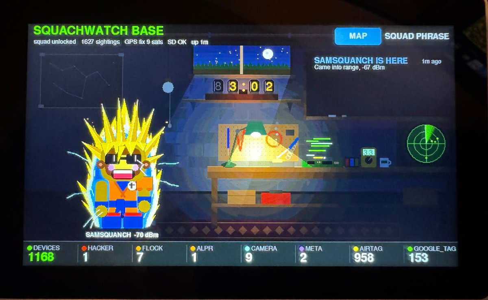
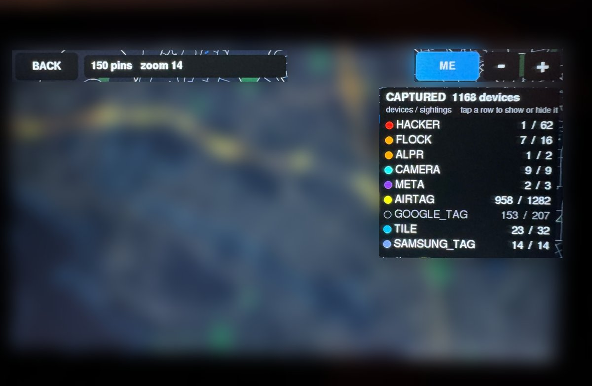

# M5Stack Tab5 — SquachWatch base station (BETA)



The Tab5 doesn't scan for anything itself. It's the squad's **base station**:
it listens to the SquachMesh adverts your boards already send, decrypts the
squad's alerts with your squad phrase, and puts it all on its 5" screen.
Nothing on the detector boards changes.

- **Who's here.** Each board in range stands on the rug as its own Squachy,
  in the outfit, shades and aura it's wearing. It walks in when the board
  arrives ("SAM IS HERE" on the chalkboard, and a chirp) and leaves a minute
  after it goes.
- **The basement.** A workshop half below ground: a radar sweeping with a
  blip for every catch, a laptop that flashes each catch's type, a Nixie
  clock (12 or 24 hours), smoke off the soldering iron. Visitors wander about
  and, two at a time, meet in the middle for a high five. Pull the string by
  the bulb to switch the light on or off.
- **The window.** The real sky for home: the sun's arc by day, a glow at
  sunrise and sunset, stars and the moon at night, and the weather from
  [Open-Meteo](https://open-meteo.com) once the Tab5 is on WiFi (clouds, rain,
  snow, fog, the temperature; the position is sent rounded to about a
  kilometre). Every so often something goes past outside.
- **The seasons.** A jack-o'-lantern and a ghost in October, a tree in
  December.
- **The tally** along the bottom: devices captured, per type, worst first.
- **The map.** Offline OpenStreetMap tiles from the SD card, with every
  catch as a pin, coloured by how much it matters: red for kit that attacks
  you (hacking tools, skimmers, deauth floods, evil twins), orange for
  surveillance (Flock, ALPR, Raven, Axon), and a colour of its own for each
  tracker and camera. Drag to pan (a quick flick throws it further); + and -
  to zoom, from zoom 12 down to 18, the last two enlarging the zoom-16 tiles.
  Tiles are kept decoded in memory and the ring just off the screen is loaded
  ahead, so panning only waits on the card for new ground.
- **One capture per device.** A device seen again at the same place is not a
  new catch. One seen at three or more places within two hours is
  **FOLLOWING**, with an alarm and a red ring on the map.
- **Imports.** A board's own SD log (`squachwatch-YYYYMMDD.log`, copied as it
  is) or its black box (converted with `tools/blackbox_to_tab5_import.py`),
  dropped on the card, goes on the map at the next start, so a drive with a
  GPS board shows up along its route.
- **Home sync (BETA).** With `wifi.txt` on the card the Tab5 joins your WiFi
  and answers as `squachbase.local`; a board built with `-DSQW_HOME_SYNC=1`
  that has the same WiFi saved hands over its new log rows when it is home,
  and they go on the map straight away. The board's side is a separate pull
  request.
- **Settings.** Brightness, sound (on, quiet at night, off), volume, the
  basement light, the season, 12 or 24 hours, SET HOME HERE from a GPS fix,
  WiFi, touch calibration, the last sync, and the version with the time a
  frame takes. The Tab5's battery sits by the SETTINGS button.
- **WiFi from the screen.** Settings > WIFI lists the 2.4 GHz networks the
  Tab5 can hear. Tap one and type its password on the on-screen keyboard
  (capitals, numbers, symbols). A network that joins is saved first in
  `wifi.txt`. One that doesn't says why: wrong password, not heard (out of
  range or 5 GHz only), or a security type the Tab5 can't use.
- **Touch calibration.** Settings > TOUCH shows five crosses to tap. The
  correction is saved and applied to every touch, then a drawing test shows
  the result. RESET goes back to the panel as it came.
- **Type filter.** Tap a type in the CAPTURED panel to hide or show it.
  AirTags and the other everyday trackers start hidden, or one drive is
  hundreds of pins.



## What you need

- Not the Tab5 detector build ([docs/TAB5.md](TAB5.md)): this is a separate
  program. It uses the C6 radio's stock ESP-Hosted firmware, not the sniff
  firmware the detector build writes, so going from one to the other the C6
  is flashed back too.
- An **M5Stack Tab5** running [Launcher](https://github.com/bmorcelli/Launcher),
  which installs firmware from the SD card. Don't flash it over USB with
  `pio upload` or you'll replace Launcher.
- A microSD card (FAT32).
- Optional: an **M5Stack Unit GPS** on the Grove port (Port A). The Tab5
  doesn't need one if it stays home: see `home.txt` below.
- At least one SquachWatch with **SQUACH MESH** on, and your squad phrase.

## Build and install

```bash
pio run -e tab5-base
```

Copy `.pio/build/tab5-base/firmware.bin` to the card and install it from
Launcher. Launcher shows the first five letters of the file name, so a name
that starts with the version (`v26-tab5-base.bin`) tells installs apart;
delete old installs in Launcher's PMan when its flash fills up.

## The SD card

Everything lives in `/squachwatch-base/`:

| Path | What |
|---|---|
| `squachy/` | The visitors' pictures, one per look. Copy from [`tab5_card/`](../tab5_card/squachwatch-base/). |
| `scene/` | The basement, light on and off. Copy from `tab5_card/`. |
| `wifi.txt` | For home sync and the weather. Settings > WIFI writes it for you; or by hand, a network name on one line and its password on the next, up to four pairs (home first, then a phone's hotspot), tried in turn. Stays on the card. |
| `season.txt` | Optional: `halloween`, `christmas` or `none` to override the calendar (Settings does the same). |
| `home.txt` | Where the Tab5 lives, so it needs no GPS at home: `lat,lon` on the first line, your time zone as a POSIX TZ rule on the second (for example `PST8PDT,M3.2.0,M11.1.0` for North America's Pacific). See `tab5_card/squachwatch-base/home.txt.example`. Without it, live catches have no position unless the GPS has a fix, and the clock shows UTC. |
| `tiles/z/x/y.png` | Map tiles, zoom 12–16. Make them for your area (below). |
| `catches.csv` | Written by the Tab5: every catch it hears. |
| `import/*.csv`, or any other `*.csv` beside `catches.csv` | Imports, read at every start. |

The Squachy pictures and the basement were drawn on a PC: the visitors by
SquachWatch's own drawing code, rendered once per outfit, shade and aura
(160 of them), and the basement by `tools/paint_tab5_basement.py`.

### Map tiles for your area

The Tab5 ships with no map. You make the tiles once, on a PC, for the area
around you. It needs nothing but Python, and takes a few minutes for a
town and longer for a region.

**1. Find your area's box.** Go to [bboxfinder.com](http://bboxfinder.com),
draw a rectangle around the area you want, and note the four numbers it
shows: west, south, east, north. Keep it to about 50 × 50 km at first. A
bigger area works, but it takes longer and fills more of the card (see the
table below).

**2. Download the roads.** Open `tools/tab5_map_area.overpassql` and replace
every `S,W,N,E` with your numbers in that order, south first, for example
`51.45,-0.20,51.55,-0.05`. Paste the whole query into
[overpass-turbo.eu](https://overpass-turbo.eu) and press **Run**. If it
warns about a large result, carry on. Then choose **Export** →
**raw OSM data** and save the file as `area.json`.

If Overpass times out, the box is too big for one go. Split it into two
halves, download each, and draw tiles from both into the same `tiles`
folder. The halves join up.

**3. Draw the tiles.** With [Python 3](https://www.python.org) installed:

```
pip install pillow
python tools/render_tiles.py area.json tiles 12 16 S W N E
```

The same four numbers, south, west, north, east. This uses every core
the PC has, and skips tiles with nothing on them.

**4. Copy them to the card.** Copy the `tiles` folder into
`/squachwatch-base/` on the Tab5's SD card, so you have
`/squachwatch-base/tiles/12/...` through `/16/...`. Restart the Tab5.

The two closest zooms (17 and 18) need no tiles of their own: the Tab5
enlarges zoom 16.

| Area | Tiles, zoom 12–16 | On the card |
|---|---|---|
| A town, 10 × 10 km | 500–800 | 3–4 MB |
| A city and around it, 50 × 50 km | 10,000–20,000 | 50–100 MB |
| A region, 100 × 100 km | 50,000–80,000 | 250–400 MB |

These numbers are rough. Tiles are more numerous the further you are from
the equator, and sea and empty land are skipped, so a coastal area needs
fewer. To cover a wide area without the size, draw zoom 12–14 for the
big box, then zoom 15–16 for a smaller box around home, into the same
folder:

```
python tools/render_tiles.py area.json tiles 12 14 S W N E
python tools/render_tiles.py area.json tiles 15 16 s w n e
```

Here the lower-case numbers are the smaller box, which must sit inside the
first one.

Map data © OpenStreetMap contributors (ODbL). The map screen shows the credit.

### Importing a board's log

With a GPS board (Waveshare C5 GPS, Marauder V8, CYD GPS...) plugged into a
PC:

```bash
python tools/blackbox_to_tab5_import.py COM3 MYBOARD drive.csv
```

This reads the board's black box over USB with `BLACKBOX` and writes it in
the Tab5's format. Drop `drive.csv` into `/squachwatch-base/` (or its
`import/` folder) and restart the Tab5.

## First start

1. Tap **SQUAD PHRASE** and type your squad's five words. The keyboard only
   offers words from the list. Until the phrase is set, boards show up but
   their alerts stay sealed.
2. The first time a board's presence advert arrives, it walks onto the rug.

## Status

Tested on one Tab5 with Waveshare C5 2.8 and Freenove S3 2.8 boards in the
squad, 2026-10-16 to 10-18: Bluetooth through the Tab5's ESP32-C6, squad
alerts decrypted, the GPS on Port A, the map with imports, arrivals and
departures, the light switch and the touch screen.

Known: the Tab5 doesn't take commands over USB (it prints its log there,
but its input never arrives), so everything goes through the SD card.
