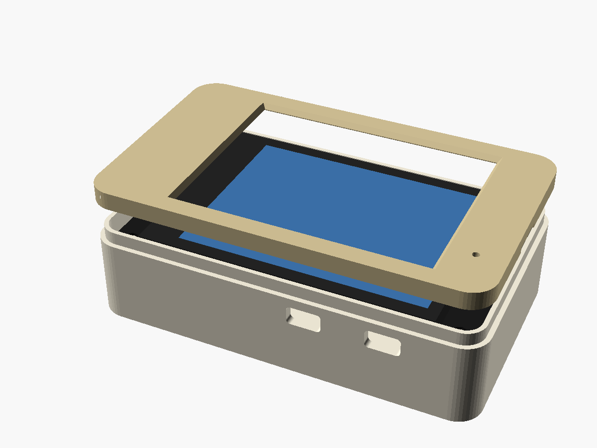

# Case: Freenove ESP32-S3 Display 2.8" (FNK0104A / FNK0104B)

A two-part, **press-fit** printed case (tub + separate lid) for the
[`freenove-s3` build](../../docs/PINOUT.md). It needs no screws or other
hardware. Outside size is 91.6 × 55 × 24 mm.

| File | What |
|---|---|
| `squachwatch_freenove_s3_28_case.scad` | Parametric source (OpenSCAD 2021+) |
| `squachwatch_freenove_s3_28_print_plate.stl` | Tub and lid side by side as separate pieces, ready to slice |
| `squachwatch_freenove_s3_28_back.stl` | Just the tub. Print floor-down, no supports |
| `squachwatch_freenove_s3_28_lid.stl` | Just the lid (front frame). Print face-down, no supports |




The dimensions come from the board's outline drawing, figure 5.1 in
`Datasheet/ES3C28P_ES2N28P_Specification_V1.0.pdf` in
[Freenove's repo](https://github.com/Freenove/Freenove_ESP32_S3_Display). The drawing gives:

- the PCB at 86 × 50 mm, with Ø3.2 holes on a 78 × 42 mm pattern
- the stack above the PCB: glue, LCD, glue and touch glass add up to 4.3 mm
- the parts on the back at up to 4.7 mm tall
- the connector positions

## What it has

- **Press-fit, no screws.** Printed pins on the tub's four posts drop into the board's corner holes. The lid's skirt slides over a step at the top of the tub and crush ribs inside it grip, while four bosses under the lid press the board's ends down onto the posts. A pry notch on the plain right end lets you get the lid off again without damage.
- **Buttons:** RESET and BOOT sit either side of the USB-C (RESET on the right, BOOT on the left, looking at the USB end with the screen up). They face the back of the board, about 13 mm above the floor, so each gets a labelled **paperclip hole** in the floor. A guide tube inside steers the clip onto the switch. BOOT is GPIO0, the firmware's button.
- **SQUACHWATCH** is engraved on the back beside the speaker grille (`logo`; set it to `""` to leave it off).
- **Openings:** USB-C on the left end; I2C and IO on the bottom edge; UART and the TF slot (with a finger scoop) on the top edge.
- **Mic:** a hole in the lid over the front-facing mic.
- **Speaker:** a pocket and grille for the 39 × 27 × 10 mm Freenove speaker, turned across the case at the USB-C end so the rest of the floor stays free (`spk_across`). Change `spk_l`, `spk_w`, `spk_d` and `spk_center` if yours is different. The speaker plugs into the PH1.25 SPEAKER header.
- **Battery:** room beside the speaker for a LiPo of about 40 × 45 × 10 mm. It plugs into the MX1.25 BAT header; check the polarity against Freenove's diagram.

## Before printing

- `btn_h`: the height of the RESET/BOOT switches off the PCB back, actuator included. I used 2.0 mm. The guide tubes stop 0.6 mm short of the switch, so if a tube touches it, raise this. Only the tub changes.
- `back_clear` is 15 mm: the 10 mm speaker plus the 4.7 mm parts on the PCB back. With no speaker or battery, about 6 is enough. `io_ports`, `sd_slot`, `mic_hole` and `speaker` each turn their feature off.
- **Lid fit:** `rib_interf` (0.2 mm) is how hard the crush ribs grip. Raise it if the lid is loose, lower it if it won't go on. Only the lid changes.

## Build

```bash
openscad -o squachwatch_freenove_s3_28_print_plate.stl squachwatch_freenove_s3_28_case.scad
openscad -D 'part="back"'  -o squachwatch_freenove_s3_28_back.stl squachwatch_freenove_s3_28_case.scad
openscad -D 'part="bezel"' -o squachwatch_freenove_s3_28_lid.stl  squachwatch_freenove_s3_28_case.scad
```

The default part, `print`, renders the tub and the lid as two separate bodies, so OpenSCAD's F6 then Export STL gives you a ready plate. `part="assembly"` shows everything exploded with a mock board; it's for looking, not printing.

## Assembly

1. Put the speaker face-down in its pocket, and stick the battery down with foam tape if you have one. Plug both in.
2. Lower the board in, screen up, so the four pins drop into its corner holes.
3. Press the lid straight down until it sits flush. To open it, put a fingernail or a flat tool in the pry notch and lift.

Print in PLA or PETG, with 0.2 mm layers and 3 walls.
