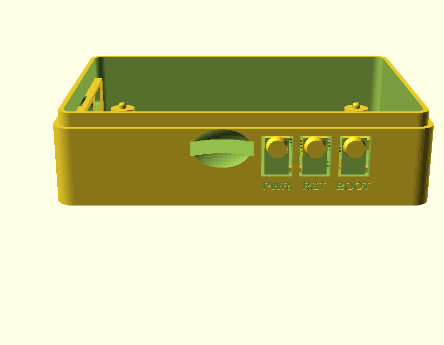
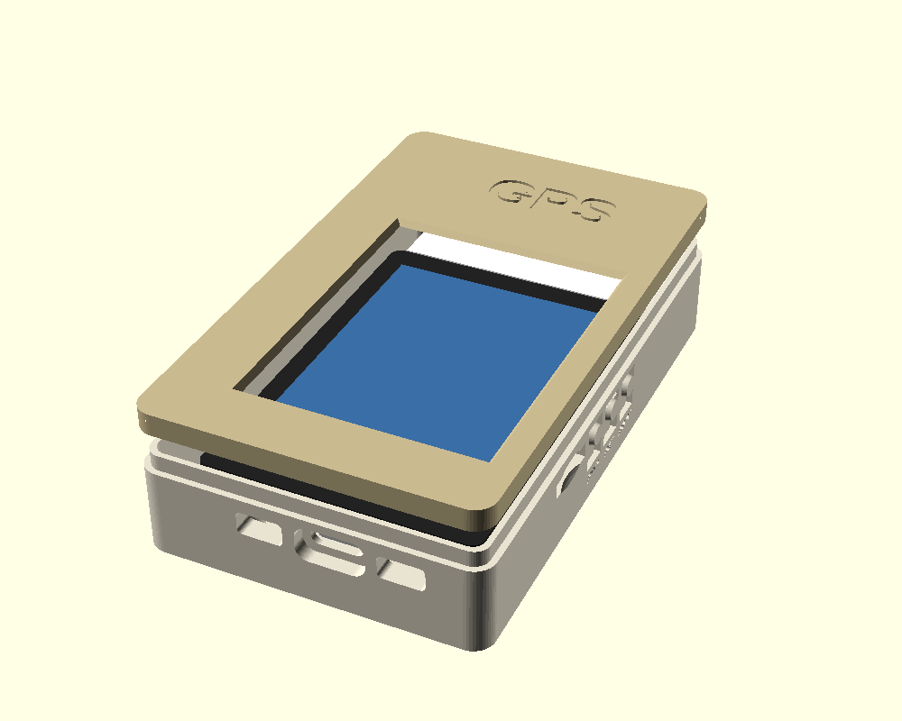

# Case: Waveshare ESP32-C5-Touch-LCD-2.8

A two-part, **press-fit** printed case (tub + separate lid) for the
[Waveshare build](../../docs/WAVESHARE-C5-28.md). It needs no screws or other
hardware. Outside size is 55.5 × 78 × 21 mm.

| File | What |
|---|---|
| `squachwatch_waveshare_c5_case.scad` | Parametric source (OpenSCAD 2021+) |
| `squachwatch_waveshare_c5_print_plate.stl` | Tub and lid side by side as separate pieces, ready to slice |
| `squachwatch_waveshare_c5_back.stl` | Just the tub. Print floor-down, no supports |
| `squachwatch_waveshare_c5_lid.stl` | Just the lid (front frame over the glass border). Print face-down, no supports |
| `squachwatch_waveshare_c5_gps_bay_*.stl` | The same three, with a bay for an M5Stack Unit GPS (see below) |


| Side buttons | Back |
|---|---|
|  |  |

## What it has

- **Press-fit, no screws.** The board has brass posts on its back corners (M2.5, 41 × 60 mm pattern). They stand on the tub's four posts, and a printed pin on each post goes up into the brass post's hole. The lid's skirt slides over a step at the top of the tub, crush ribs inside it grip, and the lid clamps the board down by the glass. A pry notch on the plain left side lets you get the lid off again without damage.
- **USB-C** cutout, with a recess so the plug's overmold can reach the port.
- **I2C** and **UART** SH1.0 header openings on the same edge (`io_ports`).
- **TF card** slot with a finger scoop on the right edge (`sd_slot`).
- **PWR / RST / BOOT** are flex tabs cut into the right wall. Each has a raised round pad outside, a nub inside that presses the side button, and its name engraved underneath (`buttons`, `button_labels`).
- **SQUACHWATCH** is engraved on the back under the speaker grille (`logo`; set it to `""` to leave it off).
- A pocket and grille for the **30 × 19 × 7 mm speaker**, which lies face-down on the floor under the top half of the board (`speaker`).
- Light holes for the board's PWR and charge LEDs, which sit on its back by the USB-C (`led_holes`). Their positions are approximate.
- Under the bottom half of the board there's about 11 mm of free height, room for a flat LiPo of roughly 35 × 30 × 5 mm or smaller. It plugs into the MX1.25 BAT connector.

## Before printing: measure two numbers

Everything came from Waveshare's dimension drawing, but that drawing doesn't give
the board's thickness. Check these with calipers and set them at the top of the `.scad`:

- `lcd_stack`: from the PCB's front face to the glass front. The default is 4.6 mm. If it's off, the lid either won't clamp the board or won't seat.
- `back_clear`: from the floor to the PCB back. The default is 11.5 mm, which leaves room for the speaker plus the parts on the PCB back. Without the speaker or a battery you can drop it to about 6.

The port positions along the edges were scaled from that drawing (±0.5 mm). If a
cutout is off, change `usb_x`, `uart_x`, `i2c_x`, `sd_y` or `btn_y`.

**Board posts:** `board_post_h` (6.0 mm, worked out from two test prints) is how tall the board's own brass posts are. The tub's posts are that much shorter than the gap under the PCB. If the glass sits proud of the tub or below its top, measure the brass posts and change this.

**Lid fit:** `rib_interf` (0.2 mm) is how hard the crush ribs grip. Raise it if the lid is loose, lower it if it won't go on. Only the lid changes.

## Build

```bash
openscad -o squachwatch_waveshare_c5_print_plate.stl squachwatch_waveshare_c5_case.scad
openscad -D 'part="back"'  -o squachwatch_waveshare_c5_back.stl squachwatch_waveshare_c5_case.scad
openscad -D 'part="bezel"' -o squachwatch_waveshare_c5_lid.stl  squachwatch_waveshare_c5_case.scad
```

With `-D gps_bay=true` the same commands give the GPS bay version (save them
as `squachwatch_waveshare_c5_gps_bay_*.stl`).

The default part, `print`, renders the tub and the lid as two separate bodies, so OpenSCAD's F6 then Export STL gives you a ready plate. `part="assembly"` shows everything exploded with a mock board; it's for looking, not printing.

## Assembly

1. Put the speaker face-down in its pocket, then plug it into the Speaker header. If you use a battery, stick it to the floor below the speaker with foam tape and plug it into BAT.
2. Lower the board in, screen up, so its brass posts land on the tub's posts with the pins inside them.
3. Press the lid straight down until it sits flush. To open it, put a fingernail or a flat tool in the pry notch and lift.

Print in PLA or PETG with 0.2 mm layers and 3 walls. For the flex tabs, PETG springs back better.

## GPS bay version

For the GPS build (`waveshare-c5-28-gps`) with an **M5Stack Unit GPS v1.1**
inside instead of on a cable:

- The case grows **28 mm longer** at the end with no ports (past the top of
  the screen) and **8 mm wider** on the plain left side: 63.4 x 105.7 x 20.9 mm.
- The GPS sits on a block in the bay, **label up, plug to the left**, its top
  just under the lid, so the lid holds it down. Only the lid's 1.2 mm is
  between its antenna and the sky; "GPS" is engraved over it.
- Its wires drop from the plug into the strip beside the board and run to
  the 12-pin connector: the GPS's TX to **IO3**, **3V3**, **GND**.
- Bay sizes are parameters (`gps_l`, `gps_w`, `gps_t`, `gps_plug`), set for
  a unit measured at about 49 x 25 x 8.5 mm with its plug 5-6 mm proud.


